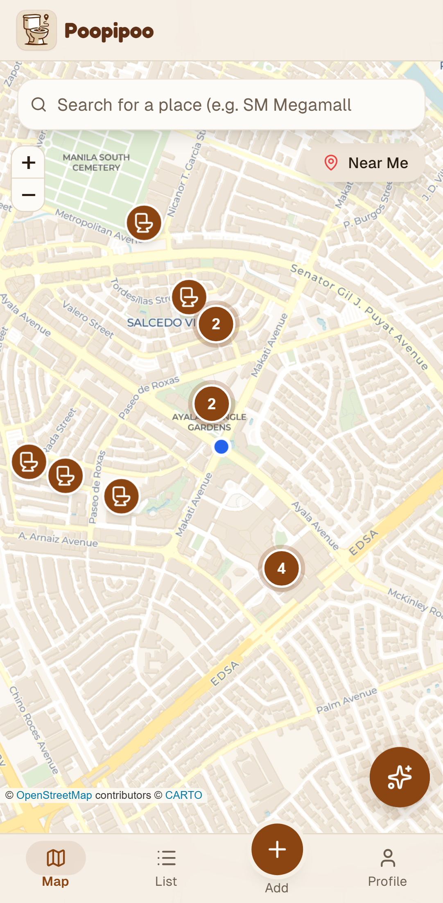
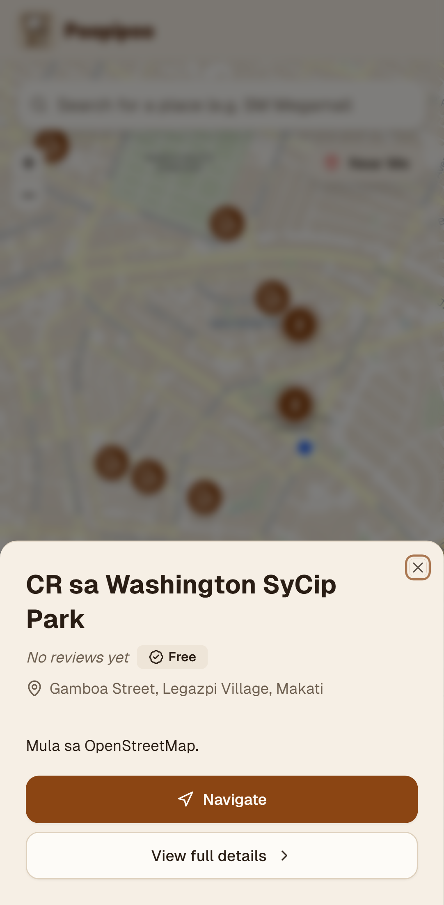
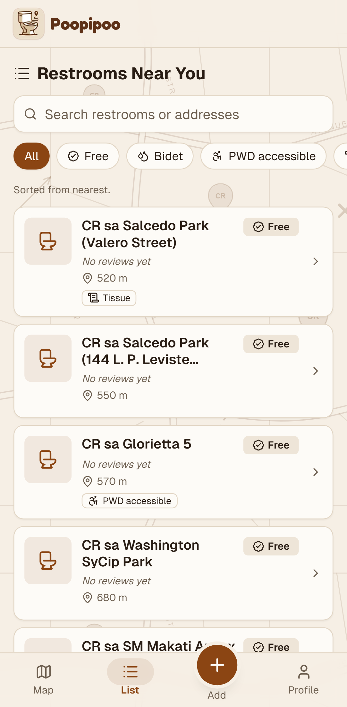
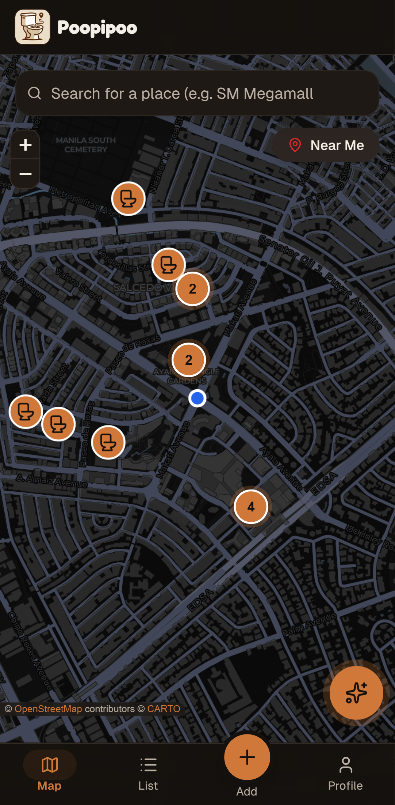
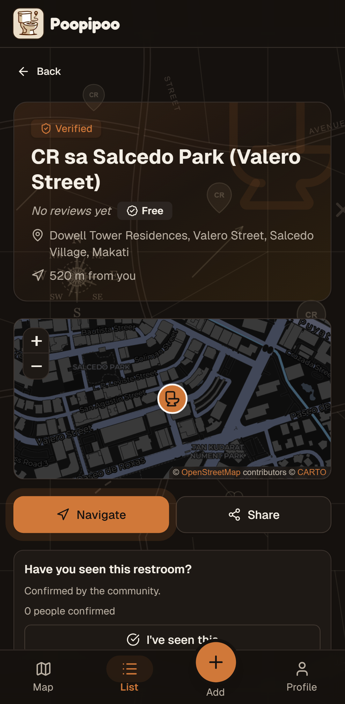
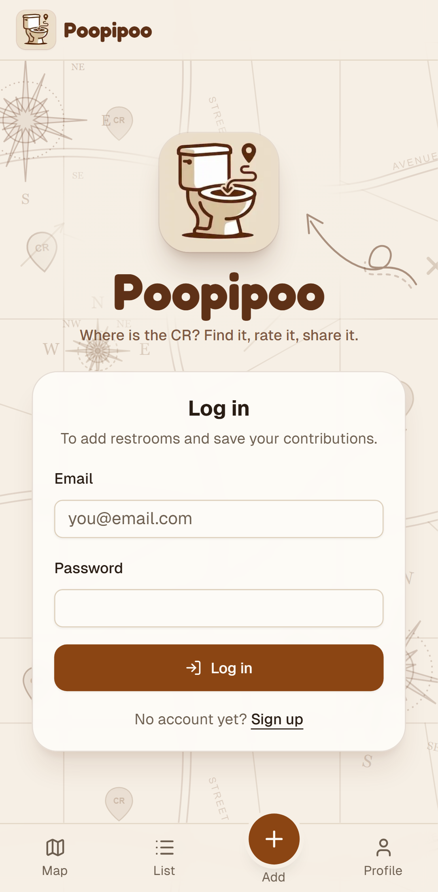
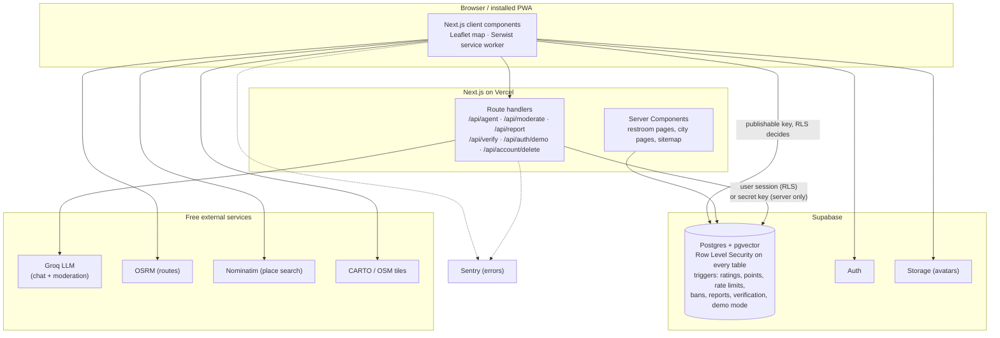

<p align="center">
  
</p>

<h1 align="center">Poopipoo</h1>

<p align="center">
  <strong>"Waze for restrooms" in the Philippines.</strong><br>
  Find the nearest clean CR, see what it has, and get directions. Built by the community, in Tagalog and English.
</p>

<p align="center">
  <a href="https://poopipoo.vercel.app"><strong>Live demo</strong></a> ·
  <a href="#try-it-without-signing-up">Try it without signing up</a> ·
  <a href="#challenges-i-solved">Challenges I solved</a> ·
  <a href="#getting-started">Run it locally</a>
</p>

<p align="center">
  <a href="https://github.com/BryxCinco/poopipoo/actions/workflows/ci.yml"></a>
  
  
  
  
</p>

---

## Screenshots

<p align="center">
  
  
  
</p>
<p align="center">
  
  
  
</p>
<p align="center"><sub>Mobile (Pixel 7), light and dark mode. Real data from OpenStreetMap and the community.</sub></p>

## Try it without signing up

Open the [live app](https://poopipoo.vercel.app/auth/login) and press **Try demo** on the login or sign-up page. You don't need an email or a password: you're signed in to a shared demo account right away.

In demo mode you can:

- ask the **AI assistant** up to 3 questions ("May CR ba na may bidet sa Makati?")
- **write reviews** (only you can see them, and they don't change any ratings)
- browse, search, filter and **navigate** like any user

Profile editing, account deletion, adding restrooms, reporting and verifying are turned off, so the demo can't affect real users. How that's enforced is in [Challenges I solved](#4-a-demo-account-that-cant-affect-real-users).

## Features

- **Map and list.** Restrooms near you with filters (free, bidet, wheelchair, tissue, soap, aircon) and place search. Pins group into count bubbles when zoomed out.
- **Restroom pages.** Amenities, ratings and reviews, a share link, and turn-by-turn navigation with voice (OSRM routing).
- **Contribute.** Add a restroom in four steps (pin on a map, details, amenities, review), write reviews, and vote reviews "helpful".
- **AI assistant.** Ask in Tagalog or English. It searches our own data with retrieval (pgvector) and tool calling, then answers with restroom cards.
- **Gamification.** Points, five levels, badges, and a leaderboard.
- **Anti-spam and moderation.** Rate limits, reports, community verification ("I've seen this", 5 = verified), AI moderation of new restrooms, a moderator dashboard, bans, and a trust score.
- **Real data.** Public toilets imported from OpenStreetMap (Metro Manila, Cebu, Davao, Iloilo, Bacolod), plus community additions.
- **PWA.** Installable and works offline for pages you've visited. Light and dark mode. Mobile first, built for 375px screens.

## Architecture



The database is the source of truth for the rules: points, rate limits, ban checks, moderation thresholds and demo-mode limits are Postgres triggers and RLS policies. The UI only explains what the database already enforces. More detail is in [docs/database.md](docs/database.md) and [docs/api.md](docs/api.md).

## Challenges I solved

### 1. Security in the database, not in the UI

The browser talks to Postgres directly with a public key, so every rule has to hold even against someone calling the API by hand.

- **Row Level Security on every table.** For example, rejected restrooms and reviews are hidden from everyone except their author and moderators.
- **Column-level grants.** Users can only write `name`, `address`, `rating`, `comment` and similar columns. Points, levels, ratings, moderation status and trust scores are written only by `SECURITY DEFINER` triggers, so nobody can give themselves points with a crafted request.
- **The secret key stays on the server.** Only route handlers use it, and only for things a user can't be allowed to do (AI moderation results, badges, account deletion).
- **CSRF checks** on every POST route, and security headers on every response.

### 2. Rate limits that can't be bypassed

- **Adding restrooms** is limited to 1 per 5 minutes, 5 per day and 20 per week, enforced by a `BEFORE INSERT` trigger. Submissions are logged in a separate table, so add → delete → add doesn't reset the limit.
- **Reports** are limited to 10 per day. Reports flag content at 3 and hide it at 5.
- **AI assistant:** 10 questions per minute per user, counted in Postgres so the limit holds across serverless instances.
- The app reads the exact "try again at" time from the trigger's error and shows it in the user's language.

### 3. Viewport-based loading (the 1000-row bug)

The map used to load the whole `restrooms` table. Supabase returns at most 1000 rows, so after the OpenStreetMap import, restrooms started **silently disappearing** from the map. Now:

- The map asks only for the **bounding box in view**, plus a 25% margin. It refetches on `moveend` (debounced) and skips the request when the loaded area still covers the view.
- Each request has a **cap of 200 pins**. One extra row is fetched to detect when an area has more, and then the map says "Zoom in to see all restrooms" instead of hiding them.
- The list page loads a 10 km area around the user.
- Pins are clustered on a screen grid without an extra library, so even a full city view stays smooth on a phone.

### 4. A demo account that can't affect real users

Recruiters shouldn't have to sign up to try the AI. But a shared account that anyone can use is a risk. [`0009_demo_mode.sql`](supabase/migrations/0009_demo_mode.sql) makes it safe at the database level:

- **Signing in.** The server creates a one-time magic-link token with the secret key and redeems it right away. There's no shared password to leak or change. The route refuses any account that isn't marked as demo in `app_metadata`, which users can't edit.
- **Private reviews.** Demo reviews are visible only to the demo account, they're excluded from ratings, and they're deleted after an hour.
- **No points.** The demo account earns no points, so it never appears on the leaderboard.
- **Read-only.** Triggers block every other write: restrooms, reports, verifications, votes, and profile/avatar edits.
- **AI limits.** 3 AI questions per demo session, counted by the session id from the JWT (so it can't be faked), plus a global hourly cap to protect the free Groq quota.

### 5. An AI assistant grounded in real data (RAG + tool calling)

The assistant doesn't make up restrooms. Each restroom is embedded with `all-MiniLM-L6-v2` (384 dimensions, run locally with transformers.js, so it's free) and stored in **pgvector**.

The Groq model (`gpt-oss-120b`) answers through **tools**:

- vector search, with a keyword fallback
- nearest restrooms to the user
- restroom details

Every restroom id the model returns is checked against the database before it's shown as a card. The same model checks each new restroom for spam or duplicates. It gets nearby restrooms and the author's recent activity as context, and suspicious entries go to the moderator queue.

### 6. Free all the way down

The whole app runs on free tiers. There's no Google Maps or Mapbox. Leaflet with OSM/CARTO tiles, OSRM routing and Nominatim search are used within their usage policies: requests are throttled to 1 per second, results are cached, and OpenStreetMap is credited.

## Tech stack

| Area | Choice |
| --- | --- |
| Framework | **Next.js 14** (App Router, Server Components), **TypeScript** (strict, no `any`), React 18 |
| UI | **Tailwind CSS**, **shadcn/ui** (Radix), Framer Motion, Lucide icons |
| Backend | **Supabase**: Postgres, Auth, Storage, Row Level Security, **pgvector** |
| Maps | **Leaflet** + OpenStreetMap data, CARTO tiles, **OSRM** routing, **Nominatim** search |
| AI | **Groq** (`openai/gpt-oss-120b`) for chat and moderation; `all-MiniLM-L6-v2` embeddings via transformers.js |
| PWA | Serwist |
| Quality | GitHub Actions CI, **Playwright** e2e tests, ESLint, **Sentry** error monitoring |
| Hosting | **Vercel** (with Web Analytics and Speed Insights) |

## Testing and CI

Every push and pull request runs [`.github/workflows/ci.yml`](.github/workflows/ci.yml): type check, lint, production build, then the **Playwright** end-to-end tests on a mobile viewport. `main` is protected by this check.

The e2e tests ([tests/e2e/](tests/e2e/)) follow a real user flow: search for a place → open a restroom → navigate → see the route on the map. They mock Supabase, Nominatim and OSRM with `page.route`, so CI needs no secrets and doesn't depend on live data.

```bash
npm run build && npm run test:e2e
```

## Getting started

Requirements: Node.js 20.12+ and a free [Supabase](https://supabase.com) project.

```bash
git clone https://github.com/BryxCinco/poopipoo.git
cd poopipoo
npm install
cp .env.example .env.local   # then fill it in (see below)
```

1. **Database.** In Supabase → SQL Editor, run the files in `supabase/migrations/` in order (`0001` to `0007`, then `0009`; there is no `0008`). Each one is safe to re-run.
2. **Auth.** In Supabase → Authentication → URL Configuration, set the Site URL to `http://localhost:3000` (and your production URL later) and add `/auth/callback` to the redirect URLs.
3. **Data (optional):**
   ```bash
   npx tsx scripts/seed-restrooms.ts          # 10 sample restrooms
   npx tsx scripts/import-osm.ts --dry-run    # preview the OpenStreetMap import
   npx tsx scripts/import-osm.ts              # import public toilets (Metro Manila, Cebu, Davao, Iloilo, Bacolod)
   npx tsx scripts/import-osm.ts --city=cebu  # or only some cities (slugs in lib/cities.ts)
   npx tsx scripts/rename-osm-restrooms.ts    # name old "Public CR" imports after a nearby landmark or street
   npx tsx scripts/generate-embeddings.ts     # vectors for the AI search (local model, ~23 MB download once)
   ```
   `scripts/seed-manila-cr.sql` adds 20 hand-picked Manila restrooms (run it in the SQL Editor).
4. **Demo mode (optional):** after running `0009_demo_mode.sql`, create the demo account. The script prints `DEMO_USER_ID=...`: add it to `.env.local`, and to Vercel for production. Without it, the "Try demo" button is hidden.
   ```bash
   npx tsx scripts/create-demo-user.ts
   ```
5. **Run:**
   ```bash
   npm run dev
   ```
   Open http://localhost:3000.

To make yourself an admin (for `/moderation`), run in the SQL Editor:

```sql
update public.profiles set role = 'admin' where username = 'your-username';
```

### Environment variables

| Name | Where | What |
| --- | --- | --- |
| `NEXT_PUBLIC_SUPABASE_URL` | browser + server | Supabase project URL |
| `NEXT_PUBLIC_SUPABASE_PUBLISHABLE_KEY` | browser + server | Publishable key (`sb_publishable_...`); RLS limits what it can do |
| `SUPABASE_SECRET_KEY` | **server only** | Secret key (`sb_secret_...`); bypasses RLS. Never expose it |
| `GROQ_API_KEY` | server only | AI assistant and AI moderation |
| `HUGGINGFACE_API_KEY` | server only | Optional. Embeddings via the API (token with "Inference Providers" permission). Without it or without credits, the same model runs locally |
| `NEXT_PUBLIC_CARTO_API_KEY` | browser | Optional CARTO basemap key; without it, OpenStreetMap tiles are used |
| `NEXT_PUBLIC_SITE_URL` | server | Optional. Canonical site URL for metadata and the sitemap (Vercel's production URL is used by default) |
| `DEMO_USER_ID` | server only | Optional. The demo account's id (from `scripts/create-demo-user.ts`); turns on "Try demo" |
| `NEXT_PUBLIC_SENTRY_DSN` | browser + server | Optional. Sentry error monitoring; off without it |
| `SENTRY_AUTH_TOKEN`, `SENTRY_ORG`, `SENTRY_PROJECT` | build only | Optional. Uploads source maps to Sentry for readable stack traces |

### Scripts

| Command | What |
| --- | --- |
| `npm run dev` | Development server (service worker off) |
| `npm run build` / `npm start` | Production build / server |
| `npm run lint` | ESLint |
| `npm run typecheck` | Type check (`tsc --noEmit`) |
| `npm run test:e2e` | Playwright e2e tests (needs a build first) |

## Deployment (Vercel)

1. Import the GitHub repo in Vercel (framework: Next.js).
2. Add the environment variables above in Project → Settings → Environment Variables.
3. In Supabase → Authentication → URL Configuration, add your Vercel URL as Site URL and `https://<your-domain>/auth/callback` as a redirect URL.
4. Enable **Analytics** and **Speed Insights** in the Vercel project to see the data.
5. Every push to `main` deploys to production.

After a deploy, installed PWAs may show the old version until reloaded (Ctrl+Shift+R, or close and reopen the app).

## Project structure

```
app/          routes (App Router), API route handlers, sitemap, robots, OG image
components/   UI by feature: map, restroom, add, agent, moderation, profile, ...
hooks/        client hooks (restrooms store, geolocation, navigation, i18n, ...)
lib/          data access, AI (agent, RAG, moderation), i18n dictionaries, routing, OSM
types/        shared TypeScript types, including the hand-written Supabase types
supabase/     SQL migrations
scripts/      seed, OSM import, embeddings, demo account
tests/e2e/    Playwright end-to-end tests
docs/         API, database and component docs, screenshots
```

## Contributing

1. Fork and create a branch from `main`.
2. Keep TypeScript strict (no `any`), use Lucide icons (no emoji in the UI), and design for 375px first.
3. Every new UI text goes in **both** `lib/i18n/dictionaries/tl.ts` and `en.ts` (TypeScript checks that the keys match).
4. Schema changes go in a new numbered file in `supabase/migrations/` (re-runnable), with `types/database.ts` updated to match.
5. Before opening a pull request: `npm run typecheck`, `npm run lint` and `npm run build` must pass. CI also runs the e2e tests.

Restroom data errors (wrong location, closed CR) can be reported from the restroom's page in the app.

## Data and credits

- Map data and imported restrooms: © [OpenStreetMap contributors](https://www.openstreetmap.org/copyright), available under the Open Database License (ODbL). Imported restrooms show this credit on their page.
- Map tiles: © [CARTO](https://carto.com/attributions).
- Routing: [OSRM](https://project-osrm.org) via routing.openstreetmap.de. Search: [Nominatim](https://nominatim.org).

See the About page in the app for the full list.
