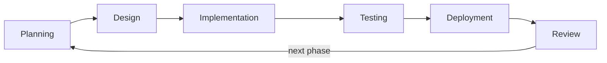

# Chapter 4. Methodology

## 4.1 Software development model

Poopipoo was developed with an **Agile, incremental** model. Instead of designing the whole system first and building it at the end, as in the Waterfall model, the system was built in **thirteen phases**. Each phase added one complete, working slice of functionality, and the application was usable, committed to version control and, once hosting was set up, deployed at the end of every phase.

This model was chosen because:

- **requirements changed while building.** For example, the need for moderation only became clear once anyone could add data, and OpenStreetMap import was added to solve the empty-map (cold-start) problem;
- **risk is reduced early.** The riskiest parts (map performance, free routing, the AI assistant) were tried in early phases, so problems surfaced while they were still cheap to fix;
- **a working product exists at every stage.** Each phase ended with something that could be demonstrated and tested.

### Iteration cycle

Every phase followed the same cycle:

| Step | What was done |
| --- | --- |
| Planning | A written phase brief: goals, tasks, rules (e.g., "no paid APIs", "mobile-first, test at 375px", "English and Tagalog for every text") and success criteria |
| Design | Data model and migration design, choice of services, UI layout; open questions were resolved with the author before building |
| Implementation | Code in small steps, with TypeScript strict mode and no `any` |
| Testing | Type check, lint, production build, automated browser and database tests, accessibility audit (see 4.4) |
| Deployment | Git commit for the phase; push to GitHub, which deploys automatically to Vercel; database migrations run in the Supabase SQL Editor |
| Review | Production checks, a report of what was done, decisions made and known limitations, and the plan for the next phase |

## 4.2 Development phases

The table lists each phase and the date and time of its Git commit (Philippine time). The whole system, from the first scaffold to the Phase 13 release, was built between **5 and 8 October 2026**.

| Phase | Scope | Completed (commit) |
| --- | --- | --- |
| 1 | Scaffold: Next.js, TypeScript, Tailwind, layout, PWA | Oct 5, 00:52 |
| 2 | Map (Leaflet) with mock restroom pins | Oct 5, 01:07 |
| 3 | UI pages, real icons, filters | Oct 5, 01:23 |
| 4 | Add-restroom and profile pages, local state | Oct 5, 01:45 |
| 5 | Supabase: database, authentication, Row Level Security | Oct 6, 02:56 |
| 6 | Ratings and reviews | Oct 6, 23:38 |
| 7 | Free navigation (OSRM), no Google Maps | Oct 7, 00:50 |
| 8 | AI agent: RAG with Groq and Hugging Face embeddings | Oct 7, 02:41 |
| 9 | Modern UI: CARTO Voyager tiles, animations, modals | Oct 7, 03:46 |
| 10 | Gamification, search, settings, About page; English and Tagalog support (Oct 8, 00:34) | Oct 7, 23:58 |
| 11 | Anti-spam and moderation | Oct 8, 01:30 |
| 12 | OpenStreetMap import, SEO, analytics, security, documentation | Oct 8, 17:53 |
| — | Brand identity: logo, app icons, paper-map theme, poster-style login | Oct 8, 20:36 and 20:54 |
| 13 | Growth and community: landmark-based names, four more cities, city pages, account deletion, local embeddings | Oct 8, 23:18 |

The commit history is public in the GitHub repository and is the primary record of the development timeline.

## 4.3 Tools and environment

| Category | Tool |
| --- | --- |
| Language and framework | TypeScript (strict), Next.js 14 (App Router), React 18 |
| Styling and UI | Tailwind CSS, shadcn/ui (Radix UI), Framer Motion, Lucide icons |
| Database, auth, storage | Supabase (PostgreSQL, pgvector, Row Level Security, Storage) |
| Maps and geodata | Leaflet, CARTO tiles, OpenStreetMap, Overpass API, Nominatim, OSRM |
| AI | Groq (`gpt-oss-120b`), all-MiniLM-L6-v2 via Hugging Face or transformers.js |
| Version control | Git and GitHub |
| Deployment (CI/CD) | Vercel: every push to `main` is built and deployed automatically |
| Monitoring | Vercel Web Analytics and Speed Insights |
| Code editor | Visual Studio Code |
| AI coding assistant | Claude Code (Anthropic) |

### Use of an AI coding assistant

The application was developed with **Claude Code**, an AI coding assistant, as a pair programmer. The author defined the product and the requirements of each phase, set the rules the code had to follow, answered design questions (for example, whether new restrooms should be visible before approval, and which data to import), reviewed the results, ran the database migrations, tested on real devices and deployed the system. The assistant proposed designs, wrote most of the code and documentation, and ran the automated tests under the author's direction. This is disclosed here for academic transparency. *[check your school's policy on AI-assisted work and adjust this paragraph to match it]*

## 4.4 Testing and quality assurance

Every phase had to pass the same **quality gates** before it was committed:

1. `tsc --noEmit`: TypeScript type check in strict mode;
2. `npm run lint`: ESLint (Next.js rules);
3. `npm run build`: a successful production build.

On top of these, the following kinds of tests were run:

| Test type | Method | Example coverage |
| --- | --- | --- |
| End-to-end UI tests | Scripts that drive a headless Chromium browser (Microsoft Edge) through the Chrome DevTools Protocol, at a 375 px phone viewport and 1440 px desktop | Logging in, adding a restroom, verifying, reporting, the moderator dashboard, banning, account deletion |
| Database tests | Scripts that call the Supabase REST API as temporary users with different roles | Rate limits, verification thresholds, report thresholds, bans, trust score, Row Level Security |
| Accessibility | axe-core 4.10.2 with the WCAG 2.0 A/AA and WCAG 2.1 AA rule sets, in light and dark mode | Labels, contrast, landmarks, focus in modals |
| Responsive layout | Screenshots and measurements at several viewport sizes, including simulated desktop zoom from 100% to 200% | No horizontal scrolling at 375 px; the whole login form reachable at any zoom level |
| Production checks | The same scripts run against the live site after each deploy | Icons, manifest, sitemap, city pages, account deletion, the AI assistant |

Temporary test users and test data were created and removed by each script, so tests could run against the real database without leaving data behind.

**Final results (October 2026):**

| Suite | Result |
| --- | --- |
| Phase 11 UI (moderation flows) | 29 / 29 passed |
| Database rules | 63 / 63 passed |
| Phase 12 (OSM data, SEO, security headers, offline) | 42 / 42 passed |
| Brand and theme (icons, manifest, all pages in light and dark) | 41 / 41 passed |
| Phase 13 pages (city pages, About, sitemap, metadata) | 34 / 34 passed |
| Account deletion, end to end | 18 / 18 passed |
| Login and signup at desktop zoom levels | 20 / 20 reachability checks passed |

In the zoom test, four stricter checks of the form "fits without scrolling" did not pass: the login form fits without scrolling up to 150% zoom, and the longer signup form needs scrolling from 125%. All parts remain reachable at every zoom level.

The test scripts were run during development but are not yet part of the repository. Adding them, with a test runner, is listed as future work.

## 4.5 Data gathering

Data for the system came from three sources:

1. **OpenStreetMap,** through the Overpass API: all `amenity=toilets` elements in each city's area. Private, staff-only and disused toilets were excluded, as were toilets within 30 m of an existing restroom with a similar name. Missing addresses were filled with Nominatim reverse geocoding, at most one request per second as its usage policy requires.
2. **Manual seeding:** 30 restrooms at well-known public places in Metro Manila, entered by the author.
3. **Community contributions** through the app, after launch.

Toilets without a name in OSM, or with a generic name such as "Toilet" or "men/women", were given descriptive names automatically. The script uses the nearest suitable landmark from OSM (a mall, park, station, school, gas station and so on, within a distance that depends on the kind of place) and otherwise the street and barangay, for example "CR sa Rizal Park" or "CR sa Taft Avenue, Malate".

## 4.6 Ethical and legal considerations

- **Data licensing:** OSM data is used under the ODbL, with attribution on the About page and on every imported restroom's page.
- **Service usage policies:** the Nominatim and Overpass usage policies were followed (identifying User-Agent, rate limiting, no bulk geocoding beyond need).
- **Privacy:** personal data is limited to what accounts need, in line with the Data Privacy Act of 2012. Users can export their data and permanently delete their account, and a Privacy Policy page explains what is stored and which third-party services are used.
- **Secrets:** API keys are kept in environment variables, the server-only key is never sent to the browser, and secrets are excluded from version control.
