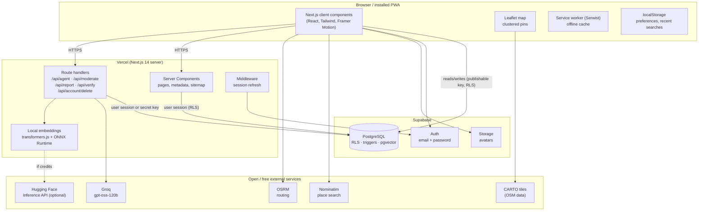
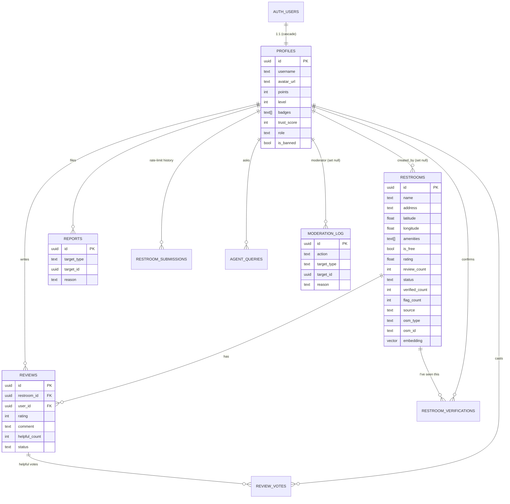
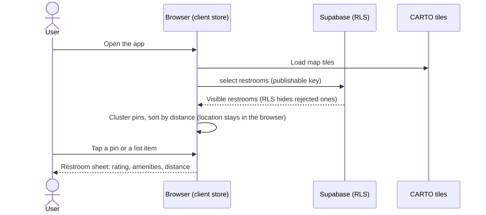
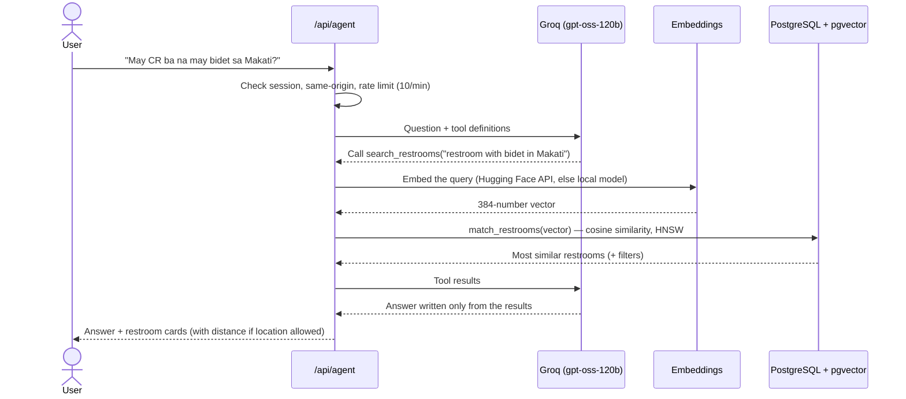
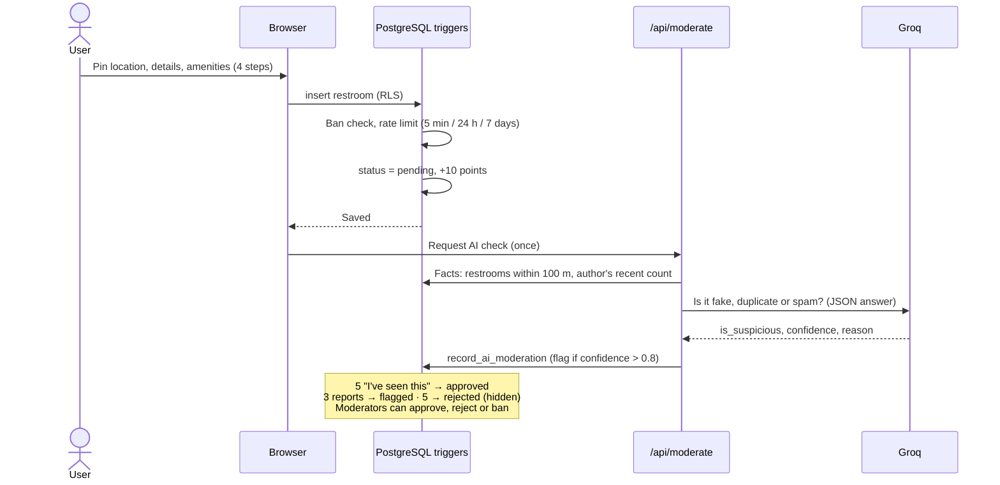
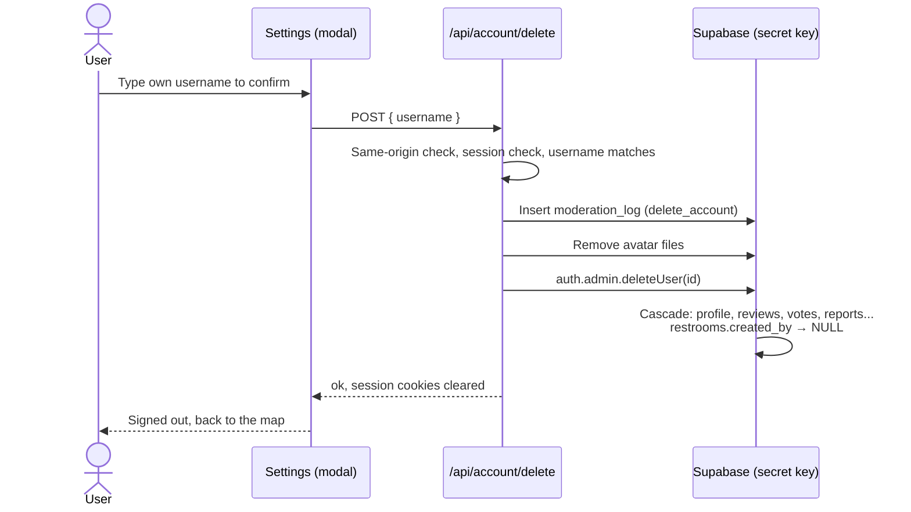
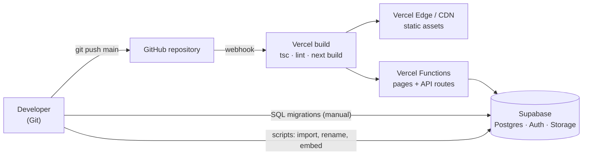

# Chapter 5. System Architecture

## 5.1 High-level architecture

Poopipoo is a **three-tier web application** built on managed, free-tier services:

1. **Presentation tier:** the browser runs the Next.js client components, the Leaflet map and a service worker (PWA).
2. **Application tier:** the Next.js server on Vercel renders pages (React Server Components), runs the API route handlers, and refreshes sessions in middleware.
3. **Data tier:** Supabase provides PostgreSQL (with pgvector), authentication and file storage.

External open services provide map tiles, place search, routing and AI.



**Two ways to reach the database.** Ordinary reads and writes (loading restrooms, adding a review, voting) go **directly from the browser to Supabase** with the publishable key. They are safe because **Row Level Security (RLS)** and column grants in PostgreSQL decide what each user may do. Operations that need secrets or extra trust (the AI assistant, AI moderation, account deletion, writing badges and embeddings) go through **Next.js route handlers**, which run on the server and may use the server-only secret key.

## 5.2 Technology stack

| Layer | Technology | Role |
| --- | --- | --- |
| Framework | Next.js 14 (App Router), React 18, TypeScript (strict) | Pages, server rendering, API routes |
| Styling | Tailwind CSS, shadcn/ui (Radix UI), Framer Motion, Lucide | Accessible components, animations, icons |
| Map | Leaflet, react-leaflet, CARTO Voyager / Dark Matter tiles | Map display; pins grouped into count bubbles when zoomed out |
| Database | Supabase PostgreSQL, pgvector (HNSW index) | Data, rules (triggers), vector search |
| Auth and storage | Supabase Auth, Supabase Storage | Accounts, sessions (cookies), profile photos |
| Routing | OSRM on routing.openstreetmap.de (foot and car profiles) | Directions and turn-by-turn steps |
| Search | Nominatim | Place names to coordinates, coordinates to addresses |
| AI | Groq (`gpt-oss-120b`), all-MiniLM-L6-v2 (Hugging Face API or transformers.js) | Assistant, moderation, embeddings |
| PWA | Serwist | Service worker, precaching, offline pages |
| Hosting | Vercel (free tier), Web Analytics, Speed Insights | Builds, deployment, CDN, metrics |

## 5.3 Application structure

```
app/           Routes (App Router): pages, API route handlers, sitemap, robots, OG image
components/    UI by feature: map, restroom, add, agent, navigation, moderation, profile, settings, ...
hooks/         Client hooks: restroom store, geolocation, navigation, i18n, theme
lib/           Data access, AI (agent, RAG, embeddings, moderation), routing, OSM, i18n dictionaries
types/         Shared TypeScript types, including the hand-written database types
supabase/      SQL migrations 0001–0007
scripts/       Seeding, OpenStreetMap import, renaming, embedding generation
docs/          API, database, component and thesis documentation
```

The codebase has about 21,800 lines of TypeScript, 1,700 lines of SQL, 14 pages, 5 API routes, 91 React components and 13 custom hooks.

### Pages

| Route | Purpose |
| --- | --- |
| `/` | Map with clustered restroom pins, search, "near me", filters, AI assistant |
| `/list` | Restrooms sorted by distance, with filters |
| `/restroom/[id]` | Details, amenities, reviews, verification, reporting, navigation |
| `/add` | Add a restroom in four steps |
| `/city/[slug]` | Restrooms in one city (for search engines and sharing) |
| `/profile`, `/leaderboard` | Points, level, badges, contributions; top contributors |
| `/settings` | Account, language, theme, AI assistant toggle, export data, delete account |
| `/moderation` | Moderator dashboard (moderators and admins only) |
| `/auth/login`, `/auth/signup` | Authentication |
| `/about`, `/privacy`, `/terms` | Information, coverage, credits, legal pages |

## 5.4 Data model



Key design points:

- **Business rules live in the database.** Seventeen triggers and 28 functions maintain ratings, points, levels, statuses, counts and the trust score, and enforce rate limits and bans. Because PostgreSQL enforces the rules, a user cannot bypass them by calling the API directly instead of using the app.
- **Row Level Security** is enabled on every table (31 policies). For example, rejected restrooms are visible only to their author and moderators, and the moderation log is visible only to moderators.
- **Column grants** limit what users can write: a user can edit a restroom's name, address and amenities, but not its rating, status, points or embedding.
- **Data provenance:** `source` marks each restroom as `user`, `seed` or `osm`. Imported rows keep their OSM id (unique), so re-running the import never creates duplicates.
- **Deletion semantics:** deleting an account cascades to the profile, reviews, votes, reports and AI usage history, while the user's restrooms remain with `created_by = NULL`, so the community does not lose them.

## 5.5 Key processes

### 5.5.1 Browsing the map



### 5.5.2 AI assistant (Retrieval-Augmented Generation)



If embeddings are unavailable, the search falls back to keyword matching. "Near me" questions skip semantic search and sort by distance.

### 5.5.3 Adding a restroom, with moderation



### 5.5.4 Navigation

The browser requests a route from OSRM (walking or driving profile) and draws it on the map. During navigation, the device's GPS position is followed, the next step is shown and spoken with the Web Speech API in Tagalog or English, and a new route is requested if the user goes off the route. Directions use the device's location only and are not stored on the server.

### 5.5.5 Account deletion



## 5.6 Security architecture

| Layer | Measure |
| --- | --- |
| Transport | HTTPS only; HSTS header |
| Browser | Security headers: `X-Frame-Options: DENY`, `X-Content-Type-Options: nosniff`, `Referrer-Policy`, `Permissions-Policy` |
| CSRF | Session cookies are `SameSite=Lax`; every POST API route also rejects requests whose `Origin` is another site |
| Authentication | Supabase Auth; sessions refreshed in middleware; server code validates the user with the Auth server (`getUser()`), not just the cookie |
| Authorization | Row Level Security on every table, column-level grants, role checks (`user`, `moderator`, `admin`) inside SECURITY DEFINER functions |
| Abuse prevention | Database rate limits, report limits, bans, AI rate limit (10 questions per minute) |
| Input validation | zod schemas on every API route; CHECK constraints in the database (lengths, ranges, allowed values) |
| Secrets | The secret key is only read on the server (no `NEXT_PUBLIC_` prefix) and never committed |
| AI safety | The assistant may only answer from tool results; tool arguments are validated before use |

## 5.7 Cross-cutting concerns

**Internationalization.** All text lives in two dictionaries, `tl.ts` (Tagalog) and `en.ts` (English). The English dictionary is typed against the Tagalog one, so the build fails if a text is missing in either language. The language is chosen from a cookie, or on the first visit from the browser's `Accept-Language` header, so server-rendered pages appear in the right language without flicker.

**PWA and offline.** Serwist precaches the application shell and caches pages and assets at runtime. The web app manifest provides maskable icons and theme colours, so the app can be installed to the home screen.

**SEO and sharing.** Every page has its own title, description, canonical URL and Open Graph and Twitter card metadata. The dynamic sitemap lists the public pages, the five city pages and every visible restroom (870 URLs). Restroom pages include JSON-LD structured data (`PublicToilet`).

**Accessibility.** Every input has a label and every icon button has an accessible name. Modals trap focus, colour contrast meets WCAG AA in light and dark mode, and layouts are tested at 375 px and at desktop zoom levels up to 200%.

## 5.8 Deployment architecture



- **Continuous deployment:** every push to `main` is built and deployed by Vercel within about two minutes.
- **Database migrations** are versioned SQL files (`0001` to `0007`), each safe to re-run, applied in the Supabase SQL Editor.
- **Data scripts** (OSM import, renaming, embedding generation) run from the developer's machine with the secret key.
- **Cost:** all services run on free tiers. The running cost of the system is ₱0.

## 5.9 Architectural decisions

| Decision | Alternatives considered | Reason |
| --- | --- | --- |
| Leaflet + OSM + CARTO tiles | Google Maps, Mapbox | Free at any scale within fair use, no API key, open data |
| OSRM public server | Google Directions, GraphHopper | Free, no key, separate walking and driving profiles |
| Rules in PostgreSQL (triggers, RLS) | Rules in the API layer | Cannot be bypassed; one source of truth for app, API and scripts |
| Browser talks directly to Supabase for ordinary data | Every request through a custom API | Less server code and latency; RLS makes it safe |
| pgvector inside the same database | A separate vector database | One system to run and back up; joins with restroom data |
| Groq with an open-weight model | OpenAI or Anthropic APIs | Free tier, fast, reliable tool calling |
| Local embeddings fallback (transformers.js) | Paying for Hugging Face credits | Free; same model, so vectors stay compatible (cosine similarity ≈ 0.99 between the two sources) |
| PWA | Native Android/iOS apps | One codebase, no app store, small download |

## 5.10 Scalability considerations

- **Database:** indexed queries, an HNSW index for vectors, and trigger-maintained counters (instead of counting on every read) keep queries fast as the data grows.
- **Client data loading:** the map currently loads all visible restrooms in one request, which suits the current 859 rows. Supabase returns at most 1,000 rows per request by default, so **before the database passes 1,000 restrooms, the map must load data by area (bounding box of the visible map) or in pages.** Otherwise the oldest restrooms would silently be left out.
- **External services:** the public Nominatim and OSRM servers have usage limits and no guarantee. At higher traffic they should be self-hosted (both are open source) or replaced with paid plans.
- **AI:** Groq's free-tier rate limits cap how many questions can be answered per minute. The per-user limit of 10 questions per minute protects that quota.
