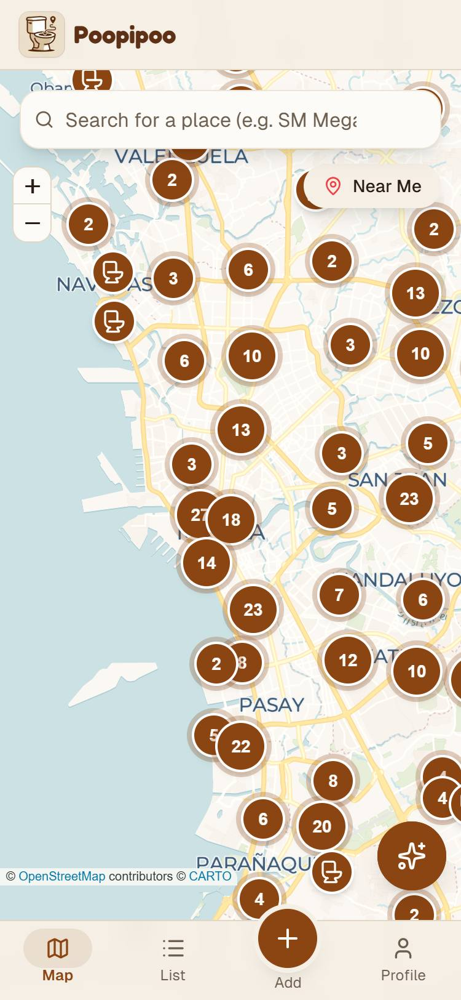
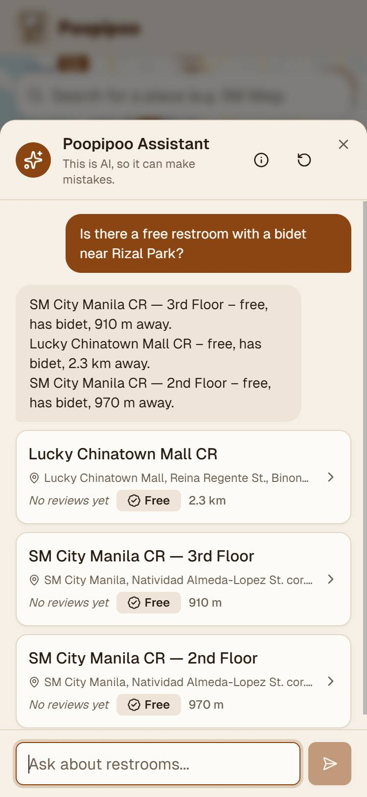
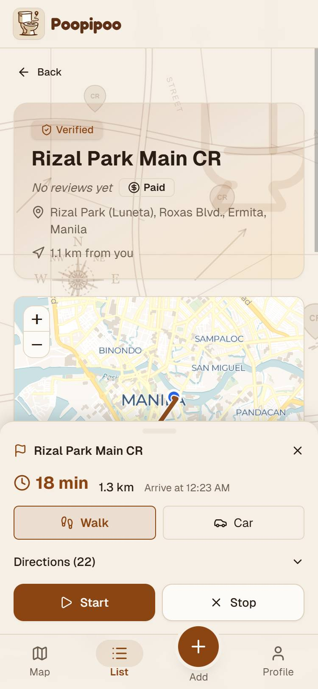
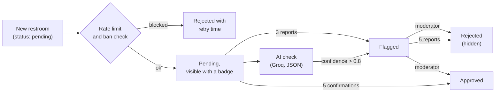

# Chapter 6. Implementation

This chapter describes how the system was built, phase by phase, then explains the main features in more detail, and ends with code statistics. The architecture behind these features is described in Chapter 5.

## 6.1 Phase-by-phase implementation

The numbers of changed files and lines come from the Git commit of each phase. Phase 1 includes the generated `package-lock.json`, which accounts for most of its lines.

| Phase | Implemented | Main files added | Files changed | Lines added / removed |
| --- | --- | --- | --- | --- |
| 1. Scaffold + PWA | Next.js 14 project, TypeScript strict, Tailwind, shadcn/ui, app layout (header, bottom navigation), Serwist service worker, web manifest | `app/layout.tsx`, `components/layout/*`, `app/sw.ts`, `public/manifest.json` | 37 | +8,831 / −0 |
| 2. Map + mock pins | Leaflet map, "near me" with browser geolocation, restroom bottom sheet, star rating, mock data | `components/map/RestroomMap.tsx`, `NearMeButton.tsx`, `RestroomSheet.tsx`, `hooks/use-geolocation.ts` | 13 | +701 / −9 |
| 3. UI + real icons + filters | List page sorted by distance, restroom detail page with mini-map, amenity icons, filters, share button | `app/list`, `app/restroom/[id]`, `RestroomList.tsx`, `RestroomFilters.tsx`, `lib/distance.ts` | 24 | +910 / −82 |
| 4. Add + profile | Four-step add-restroom form with a location picker and reverse geocoding, profile page, client restroom store | `app/add`, `AddRestroomForm.tsx`, `LocationPicker.tsx`, `lib/geocode.ts`, `lib/restroom-store.ts` | 27 | +1,721 / −169 |
| 5. Supabase + auth | PostgreSQL schema with RLS, email/password authentication, session middleware, error pages, upload of locally saved restrooms | `supabase/migrations/0001_init.sql`, `app/auth/*`, `lib/supabase/*`, `middleware.ts` | 49 | +3,111 / −368 |
| 6. Ratings + reviews | Reviews (1–5 stars and a comment), one per user per restroom, rating trigger | `0002_reviews.sql`, `ReviewForm.tsx`, `ReviewList.tsx`, `lib/reviews/queries.ts` | 14 | +1,168 / −36 |
| 7. Navigation | OSRM walking and driving routes, route layer, turn-by-turn panel, GPS following, re-routing, spoken instructions | `lib/routing.ts`, `lib/voice.ts`, `NavigationPanel.tsx`, `hooks/use-navigation.ts` | 21 | +3,905 / −47 |
| 8. AI agent | Groq tool-calling agent, RAG with pgvector and embeddings, chat UI, per-device on/off, usage stats | `app/api/agent/route.ts`, `lib/ai/*`, `AgentChat.tsx`, `0003_embeddings.sql` | 21 | +1,956 / −19 |
| 9. Modern UI | CARTO Voyager and Dark Matter tiles, dark mode, animations, modal and button system, unsaved-changes guard | `components/ui/Modal.tsx`, `ConfirmModal.tsx`, `AnimatedButton.tsx`, `lib/theme.ts` | 69 | +3,180 / −834 |
| 10. Gamification + search | Points, levels, badges, leaderboard, place search (Nominatim), onboarding, settings, About, Privacy and Terms pages, OG image; **English and Tagalog** support (separate commit) | `0004_gamification.sql`, `lib/badges.ts`, `lib/levels.ts`, `Leaderboard.tsx`, `lib/i18n/*` | 50 + 99 | +3,257 / −166 and +2,947 / −937 |
| 11. Anti-spam + moderation | Statuses, reports, verification, rate limits, trust score, bans, AI moderation, moderator dashboard | `0005_moderation.sql`, `app/api/{moderate,report,verify}`, `app/moderation`, `lib/ai/moderation.ts` | 37 | +3,604 / −52 |
| 12. OSM import + launch | Overpass import of 585 Metro Manila toilets, pin clustering, sitemap, robots.txt, JSON-LD, security headers, CSRF check, analytics, documentation | `lib/osm.ts`, `scripts/import-osm.ts`, `0006_osm.sql`, `ClusteredMarkers.tsx`, `app/sitemap.ts` | 39 | +1,342 / −59 |
| Branding | Logo, app and maskable icons, paper-map background, Fredoka wordmark, poster-style login | `components/brand/MapDecorations.tsx`, `public/patterns/*`, `AuthCard.tsx` | 20 + 21 | +214 / −89 and +278 / −102 |
| 13. Growth + community | Four more cities, landmark-based names, city pages, account deletion, local embeddings, login layout for desktop zoom | `lib/cities.ts`, `lib/osm-naming.ts`, `app/city/[slug]`, `app/api/account/delete`, `lib/ai/local-embeddings.ts`, `0007_account_deletion.sql` | 28 | +2,218 / −172 |

**Verification per phase.** Every phase passed the type check, lint and production build before it was committed. Phases 1 to 10 were also checked in the browser at a 375-pixel viewport, but those checks were not saved as reusable scripts. From Phase 11 on, the checks were written as automated scripts that were run again after each later phase (Chapter 7).

## 6.2 Key features

### 6.2.1 Map and list

- **Map:** Leaflet with CARTO tiles (light: Voyager; dark: Dark Matter). Because hundreds of pins on one screen would be slow and unreadable, nearby pins are grouped into **count bubbles** with a grid-clustering component written for the project (`ClusteredMarkers.tsx`), without an extra plugin. Tapping a bubble zooms in.
- **List:** restrooms sorted by straight-line (Haversine) distance from the user, 40 at a time with a "show more" button, and filters for free, bidet, wheelchair access, tissue, soap and air-conditioning.
- **Search:** place search through Nominatim (e.g., "SM Megamall"), with recent searches stored on the device.
- **Restroom page:** status badge, rating, price, address, distance, a mini-map, amenities (missing ones shown struck through), community verification, reviews, report and share buttons, and the OSM credit for imported restrooms.

### 6.2.2 AI assistant

The assistant (`lib/ai/agent.ts`) runs an agent loop:

1. The question, the recent conversation and three tool definitions are sent to `gpt-oss-120b` on Groq.
2. The model calls a tool. `search_restrooms` runs a semantic search: the query, which the model writes in English with full place names, is embedded and compared with the restroom embeddings in PostgreSQL (`match_restrooms`). Filters (free, amenities) and sorting by distance are applied afterwards. `get_distance` and `start_navigation` let the assistant answer "how far" questions and open directions.
3. The model writes the answer **only from the tool results**, in the user's language, and the app shows the matching restrooms as cards.

Embeddings are produced by `generateEmbedding()`. It uses the Hugging Face Inference API when the account has credits, and otherwise runs the same model locally with transformers.js. After a "no credits" response, the API is skipped for 30 minutes. Each restroom's text is built by `restroomToDocument()` (name, description, address with abbreviations expanded, such as "BGC" to "Bonifacio Global City", amenities and price). When an embedding cannot be made at all, the search falls back to keyword matching.

Requests are limited to 10 per minute per user, and the assistant can be turned off per device in Settings.

### 6.2.3 Navigation

- Routes come from the public OSRM servers at routing.openstreetmap.de, which provide separate **foot** and **car** profiles.
- The route is drawn on the map, and a panel shows the travel time, distance, arrival time and a list of steps. OSRM maneuvers are translated into Tagalog or English by `lib/routing-translations.ts`.
- During navigation the app follows the GPS position (`watchPosition`), advances the steps, speaks each instruction with the Web Speech API (`lib/voice.ts`), detects when the user is off the route and requests a new one, and announces arrival.

### 6.2.4 Gamification

| Action | Points |
| --- | --- |
| Add a restroom | +10 |
| Write a review | +5 |
| Receive a "helpful" vote on your review | +1 |

| Level | Name | Points needed |
| --- | --- | --- |
| 1 | Newbie | 0 |
| 2 | Explorer | 50 |
| 3 | Scout | 200 |
| 4 | Expert | 500 |
| 5 | Legend | 1,000 |

Six badges (`first-cr`, `reviewer`, `explorer`, `top-reviewer`, `helpful`, `legend`) reward milestones. Points and levels are maintained by the database trigger `award_points()`. Deleting a restroom or review takes its points back, so points cannot be farmed by adding and deleting. A leaderboard lists the top contributors, excluding banned users.

### 6.2.5 Anti-spam and moderation

The moderation model works in layers. Each layer is enforced in PostgreSQL (`0005_moderation.sql`):

| Rule | Value |
| --- | --- |
| New restrooms per user | 1 per 5 minutes, 5 per 24 hours, 20 per 7 days (rolling windows) |
| Reports per user | 10 per 24 hours, one per item |
| Flag / hide thresholds | 3 reports flag an item, 5 hide it |
| Approval threshold | 5 "I've seen this" confirmations from other users |
| Trust score | +2 per confirmation of your restrooms, +10 while one is approved, −20 while one is rejected |
| Bans | Hide all of the user's content and block every write; admins cannot be banned, and only admins can ban moderators |

The AI check (`/api/moderate`) gives the model facts that the server computes itself, namely the restrooms within 100 m and how many restrooms the author added in the last 24 hours, and asks for a JSON verdict. Moderators see flagged restrooms, open reports, banned users and AI-unchecked restrooms in a dashboard at `/moderation`, and every action is written to `moderation_log`.

### 6.2.6 English and Tagalog

All interface text is stored in two dictionaries (`lib/i18n/dictionaries/tl.ts` and `en.ts`, about 930 lines each). The type of the English dictionary is derived from the Tagalog one, so a missing or misspelled key is a **compile-time error**. The language is saved in a cookie, so server-rendered pages appear in the right language on first load. On a first visit, it is detected from the browser's `Accept-Language` header. Error messages from the database, route-planning instructions and spoken directions are translated as well.

### 6.2.7 Data import and naming

- `scripts/import-osm.ts --city=<slug>` fetches `amenity=toilets` for a city from the Overpass API, trying three public servers with retries. It drops private, staff-only and disused toilets and skips toilets within 30 m of an existing restroom with a similar name. It fills missing addresses with Nominatim and inserts the rows with an upsert on `(osm_type, osm_id)`.
- Unnamed or generically named toilets ("Toilet", "Male Urinal", "men/women") get a descriptive name from `lib/osm-naming.ts`. A landmark within 25 m is used first (except food stalls, which are often right next to a mall's or park's CR). Otherwise the nearest suitable large landmark within a radius that depends on its kind (for example, 300 m for a mall, 800 m for an airport) is used. If there is none, the street and barangay are used. Duplicate names get the street in parentheses or a number. Examples: "CR sa Rizal Park", "CR sa Petron (Rizal Avenue)", "CR sa Ateneo de Manila University (Parade Loop)".

### 6.2.8 Accounts and privacy features

Settings lets users change their username and photo, language, theme and the AI-assistant toggle, export their data as JSON, clear the data saved on the device, and permanently delete their account. Deletion requires typing the username, which the server checks again. It is logged, removes the avatar files, and deletes the authentication user; the database cascade then removes the profile and the user's reviews, votes and reports, and keeps their restrooms without their name.

## 6.3 Code statistics

Counted from the files tracked in Git, October 2026.

| Area | Files | Lines |
| --- | --- | --- |
| `app/` (pages, API routes) | 35 | 2,344 |
| `components/` | 92 | 10,791 |
| `lib/` (logic, data access, AI, i18n) | 58 | 6,628 |
| `hooks/` | 13 | 954 |
| `types/` | 5 | 464 |
| `scripts/` | 4 | 475 |
| **TypeScript total** | **207** | **≈21,700** |
| SQL migrations | 7 | 1,712 |

| Measure | Count |
| --- | --- |
| Pages (routes) | 14 |
| API route handlers | 5 |
| React components (`.tsx`) | 91 |
| Custom hooks | 13 |
| Database triggers / functions / RLS policies | 17 / 28 / 31 |
| Runtime dependencies / development dependencies | 32 / 10 |
| Files tracked in Git | 244 |
| Commits | 19 |
| Automated checks in the final test run | 251 (247 passed; see Chapter 7) |

The i18n dictionaries account for about 1,900 of the `lib/` lines.
