# Poopipoo: A Crowdsourced Restroom Finder Application for the Philippines

**Author:** Brian Francisco (BryxCinco)

**Date:** October 2026

**Version:** 1.0

**Live system:** https://poopipoo.vercel.app

**Source code:** https://github.com/BryxCinco/poopipoo

---

## Abstract

Finding a clean, accessible public restroom (locally called a *CR*, or "comfort room") is a common daily problem in Philippine cities, yet there is no free, centralized and community-maintained source of this information. This project presents **Poopipoo**, a crowdsourced restroom finder delivered as a mobile-first web application and Progressive Web App (PWA). Users can find nearby restrooms on a map or list, filter by amenities such as a bidet, tissue or wheelchair access, read and write reviews, and get walking or driving directions with spoken turn-by-turn guidance. A conversational AI assistant answers natural-language questions in Tagalog or English using Retrieval-Augmented Generation (RAG) over the project's own database.

The system was built with Next.js 14 and TypeScript on the client and server, Supabase (PostgreSQL with Row Level Security and pgvector) for data and authentication, Leaflet with OpenStreetMap data for maps, OSRM for routing, Nominatim for place search, and Groq-hosted open-weight language models for the assistant and for automated moderation. Sentence embeddings (all-MiniLM-L6-v2) are generated locally with transformers.js when the hosted inference API is unavailable. To address the cold-start problem of crowdsourced platforms, 829 public toilets were imported from OpenStreetMap under the Open Database License, giving 859 restrooms across Metro Manila, Cebu, Davao, Iloilo and Bacolod at launch. Gamification (points, levels, badges and a leaderboard) encourages contributions, while database-enforced rate limits, community verification, reports, AI moderation and a moderator dashboard protect data quality.

The application was developed in thirteen incremental phases and deployed on free tiers of Vercel and Supabase at zero cost. Automated end-to-end and database tests, accessibility audits (WCAG 2.1 AA) and production checks verified the system. The results show that a useful, privacy-conscious public-utility app can be built and operated entirely on open data and free infrastructure.

**Keywords:** crowdsourcing, volunteered geographic information, restroom finder, OpenStreetMap, Progressive Web App, Retrieval-Augmented Generation, gamification, content moderation, Philippines

---

## Table of Contents

- [Abstract](#abstract)
- [Chapter 1. Background of the Study](#chapter-1-background-of-the-study)
  - [1.1 Restroom scarcity in Philippine cities](#11-restroom-scarcity-in-philippine-cities)
  - [1.2 The cold-start problem of crowdsourced applications](#12-the-cold-start-problem-of-crowdsourced-applications)
  - [1.3 The digital divide and mobile-first design](#13-the-digital-divide-and-mobile-first-design)
  - [1.4 The open data movement](#14-the-open-data-movement)
  - [1.5 The democratization of AI](#15-the-democratization-of-ai)
  - [1.6 Local-first and privacy-first approach](#16-local-first-and-privacy-first-approach)
  - [1.7 Rationale](#17-rationale)
- [Chapter 2. The Problem](#chapter-2-the-problem)
  - [2.1 Statement of the Problem](#21-statement-of-the-problem)
  - [2.2 Objectives](#22-objectives)
  - [2.3 Significance of the Study](#23-significance-of-the-study)
  - [2.4 Scope and Limitations](#24-scope-and-limitations)
- [Chapter 3. Review of Related Literature and Systems](#chapter-3-review-of-related-literature-and-systems)
  - [3.1 Crowdsourced mapping](#31-crowdsourced-mapping)
  - [3.2 Restroom finder applications](#32-restroom-finder-applications)
  - [3.3 AI in mapping](#33-ai-in-mapping)
  - [3.4 Retrieval-Augmented Generation (RAG)](#34-retrieval-augmented-generation-rag)
  - [3.5 Gamification](#35-gamification)
  - [3.6 Trust and moderation in open platforms](#36-trust-and-moderation-in-open-platforms)
  - [3.7 Local-first software and privacy-first design](#37-local-first-software-and-privacy-first-design)
  - [3.8 Synthesis](#38-synthesis)
  - [References](#references)
- [Chapter 4. Methodology](#chapter-4-methodology)
  - [4.1 Software development model](#41-software-development-model)
  - [4.2 Development phases](#42-development-phases)
  - [4.3 Tools and environment](#43-tools-and-environment)
  - [4.4 Testing and quality assurance](#44-testing-and-quality-assurance)
  - [4.5 Data gathering](#45-data-gathering)
  - [4.6 Ethical and legal considerations](#46-ethical-and-legal-considerations)
- [Chapter 5. System Architecture](#chapter-5-system-architecture)
  - [5.1 High-level architecture](#51-high-level-architecture)
  - [5.2 Technology stack](#52-technology-stack)
  - [5.3 Application structure](#53-application-structure)
  - [5.4 Data model](#54-data-model)
  - [5.5 Key processes](#55-key-processes)
  - [5.6 Security architecture](#56-security-architecture)
  - [5.7 Cross-cutting concerns](#57-cross-cutting-concerns)
  - [5.8 Deployment architecture](#58-deployment-architecture)
  - [5.9 Architectural decisions](#59-architectural-decisions)
  - [5.10 Scalability considerations](#510-scalability-considerations)
- [Chapter 6. Implementation](#chapter-6-implementation)
  - [6.1 Phase-by-phase implementation](#61-phase-by-phase-implementation)
  - [6.2 Key features](#62-key-features)
  - [6.3 Code statistics](#63-code-statistics)
- [Chapter 7. Testing](#chapter-7-testing)
  - [7.1 Testing strategy](#71-testing-strategy)
  - [7.2 Test suites and results](#72-test-suites-and-results)
  - [7.3 Accessibility](#73-accessibility)
  - [7.4 Responsive design](#74-responsive-design)
  - [7.5 Performance](#75-performance)
  - [7.6 Security testing](#76-security-testing)
  - [7.7 Limitations of the testing](#77-limitations-of-the-testing)
- [Chapter 8. Results and Discussion](#chapter-8-results-and-discussion)
  - [8.1 Achievement of the objectives](#81-achievement-of-the-objectives)
  - [8.2 The restroom data](#82-the-restroom-data)
  - [8.3 System metrics](#83-system-metrics)
  - [8.4 Comparison with existing applications](#84-comparison-with-existing-applications)
  - [8.5 Discussion](#85-discussion)
- [Chapter 9. Summary, Conclusions and Recommendations](#chapter-9-summary-conclusions-and-recommendations)
  - [9.1 Summary](#91-summary)
  - [9.2 Conclusions](#92-conclusions)
  - [9.3 Recommendations](#93-recommendations)
  - [9.4 Future work](#94-future-work)
- [Chapter 10. References](#chapter-10-references)
  - [Books, papers and standards](#books-papers-and-standards)
  - [News and app listings](#news-and-app-listings)
  - [Open data, licenses and map services](#open-data-licenses-and-map-services)
  - [Software and documentation](#software-and-documentation)
- [Chapter 11. Appendices](#chapter-11-appendices)
  - [Appendix A. Database Schema](#appendix-a-database-schema)
  - [Appendix B. API Endpoints](#appendix-b-api-endpoints)
  - [Appendix C. Component List](#appendix-c-component-list)
  - [Appendix D. Environment Variables](#appendix-d-environment-variables)
  - [Appendix E. Deployment Guide](#appendix-e-deployment-guide)
  - [Appendix F. Code Snippets](#appendix-f-code-snippets)
  - [Appendix G. Test Results](#appendix-g-test-results)
  - [Appendix H. Screenshots](#appendix-h-screenshots)

---

# Chapter 1. Background of the Study

## 1.1 Restroom scarcity in Philippine cities

In the Philippines, a public restroom is commonly called a *CR* (comfort room). For commuters, delivery riders, tourists, parents with small children, senior citizens and persons with disabilities (PWDs), knowing where the nearest usable CR is matters every day. In practice, most restrooms people rely on are inside malls, fast-food restaurants, gas stations, transport terminals and government buildings. Their availability depends on opening hours, whether they are for customers only, whether a fee is charged, and their condition (water, tissue, soap, a bidet or *tabo*, cleanliness).

This information exists, but it is scattered: it lives in people's memories, in social media posts, and partially in general-purpose map services where restrooms are rarely the focus. There is no free, centralized and community-maintained source that answers the simple question "Saan ang pinakamalapit na malinis na CR?" (Where is the nearest clean restroom?).

The Code on Sanitation of the Philippines (Presidential Decree No. 856, 1975) sets sanitation standards for public places, but it does not provide a way for the public to *find* facilities. *[add local source: a recent report or news article on public toilet availability in Metro Manila or other cities]*

## 1.2 The cold-start problem of crowdsourced applications

Crowdsourced platforms depend on their users for content, but users only join a platform that already has useful content. This chicken-and-egg situation is known as the **cold-start problem**. A restroom finder with an empty map gives a first-time user no reason to come back, and therefore no reason to contribute.

Poopipoo addresses this by **seeding** the database before launch:

- 30 hand-entered restrooms at well-known Metro Manila locations (malls, parks, terminals), and
- 829 public toilets imported from **OpenStreetMap** (OSM), where they are mapped as `amenity=toilets`.

At launch, the map therefore shows 859 restrooms in five cities, and community contributions add to that base instead of starting from zero.

## 1.3 The digital divide and mobile-first design

For many Filipinos, the smartphone is the main or only way to access the internet, often over mobile data with limited allowances and on low- to mid-range devices. *[add local source: e.g., DataReportal "Digital 2025: The Philippines", or PSA/DICT statistics on mobile internet use]*

These conditions shaped the design:

- **Mobile-first:** every screen is designed and tested at a 375-pixel-wide viewport first, then scaled up to desktop.
- **No app-store install needed:** Poopipoo is a web app that can be installed as a **Progressive Web App (PWA)**, so it works on any phone with a modern browser and takes little storage.
- **Offline support:** a service worker caches visited pages, so a previously opened restroom page still works with a weak signal.
- **Two languages:** the interface is fully available in Tagalog and English.

## 1.4 The open data movement

**OpenStreetMap** (founded in 2004) is a collaborative map of the world built by volunteers, distributed under the **Open Database License (ODbL)**. The ODbL allows anyone to use, share and adapt the data, on the condition that the source is credited and derived databases stay open.

Poopipoo uses OSM in several ways: map data (through CARTO base map tiles), imported restroom locations, place search (Nominatim) and routing (OSRM). As the ODbL requires, every imported restroom page shows "This restroom comes from OpenStreetMap. © OpenStreetMap contributors (ODbL)", and the About page explains the license.

## 1.5 The democratization of AI

Large language models (LLMs) used to require expensive proprietary APIs. Two developments made them practical for a zero-budget project:

- **Open-weight models** that anyone can download and run, served by inference providers such as **Groq** with a free tier. Poopipoo's assistant and its automated moderation use the open-weight `gpt-oss-120b` model on Groq.
- **Small embedding models** such as **all-MiniLM-L6-v2** (sentence-transformers), which convert text into 384-number vectors for semantic search. These can be called through the Hugging Face Inference API or run directly on the server with **transformers.js** (ONNX Runtime). Poopipoo uses the API when credits are available and otherwise runs the same model itself, at no cost.

Combined with a vector database (pgvector), these components allow a small project to offer a natural-language assistant ("May CR ba na may bidet sa Makati?") that answers only from verified data in its own database.

## 1.6 Local-first and privacy-first approach

Poopipoo collects only what it needs:

- **Without an account,** the map, list, restroom pages, search and navigation all work. The user's location is used in the browser to sort restrooms by distance and to request a route (the start and end points go to the public OSRM routing server), and it is never saved in the database. (When a signed-in user asks the AI assistant a "near me" question, the location is sent with that one request so distances can be computed, including to the AI provider, but it is not stored.)
- **With an account,** users store an email, a username, an optional photo, and the restrooms, reviews and votes they add.
- **Local data:** preferences such as theme, language, recent searches and the AI-assistant toggle are kept on the device, and users can clear them from Settings.
- **User control:** users can **export** all their data as a JSON file and **permanently delete** their account. Deletion removes their profile, reviews, votes and points. Restrooms they added stay on the map without their name, because other people depend on them.
- **No tracking for advertising:** the only analytics are aggregate, cookie-free page-view and performance metrics (Vercel Web Analytics and Speed Insights).

---

## 1.7 Rationale

### Why Poopipoo?

A restroom is an urgent need, and a slow or cluttered app fails exactly when it is needed. Poopipoo focuses on one job: show the nearest suitable CR and how to get there, as quickly as possible. The friendly name and visual identity also make a sensitive topic approachable and shareable.

### Why crowdsourced?

Restroom information changes often. A CR closes, starts charging a fee, runs out of water, or is renovated. No single organization can keep this current across a country, but the people who use the restrooms every day can. The "Waze model", in which users both consume and report information, keeps the data alive. Community verification ("Nakita ko na ito", "I've seen this") and reviews give each restroom a visible track record.

### Why free?

The people who most need a public restroom finder, such as commuters, workers in the field and travellers on a budget, are the least likely to pay for one. Poopipoo is free to use, has no ads, and is built only on free tiers and open data, so it can stay free as long as it stays within those limits.

### Why no Google Maps?

Google Maps Platform and Mapbox charge per map load, search and route once a project grows past their free quota, and Google's terms restrict extracting or storing its place data, which a restroom database would need to do. Open alternatives cover every need of the project:

| Need | Open alternative used |
| --- | --- |
| Map display | Leaflet + CARTO tiles (OpenStreetMap data) |
| Place search | Nominatim |
| Directions | OSRM (routing.openstreetmap.de) |
| Restroom data | OpenStreetMap `amenity=toilets` (ODbL) + community |

This keeps the running cost at zero, avoids lock-in to a single vendor, and gives back to the open-data ecosystem through attribution and open data.

---

# Chapter 2. The Problem

## 2.1 Statement of the Problem

### General problem

There is no centralized, free and crowdsourced platform for finding public restrooms (CRs) in the Philippines.

### Specific problems

1. How can a database be designed so that it stays fast, consistent and secure for 859 or more restrooms and their reviews, votes and reports, and can keep growing?
2. How can an AI agent find restrooms from natural-language questions in Tagalog or English, without inventing places that do not exist?
3. How can navigation to a restroom be provided for free, without Google Maps?
4. How can gamification encourage users to add and review restrooms?
5. How can moderation prevent fake, duplicate and spam data in an open, crowdsourced database?
6. How can the application support both English and Tagalog throughout?
7. How can the system be deployed to production at no cost?

## 2.2 Objectives

### General objective

To develop a free, crowdsourced and AI-assisted restroom finder application for the Philippines.

### Specific objectives

| # | Objective | Outcome in the final system |
| --- | --- | --- |
| 1 | Import 500 or more restrooms from OpenStreetMap | 829 restrooms imported (Metro Manila, Cebu, Davao, Iloilo, Bacolod); 859 in total with 30 seeded entries. Unnamed toilets receive descriptive names from nearby landmarks (e.g., "CR sa Rizal Park"). |
| 2 | Implement an AI agent using Groq and Hugging Face models | Tool-calling assistant on Groq (`gpt-oss-120b`) with RAG over pgvector, using all-MiniLM-L6-v2 embeddings (Hugging Face API, or the same model run locally with transformers.js); keyword-search fallback |
| 3 | Implement free navigation using OSRM | Walking and driving routes, turn-by-turn instructions in Tagalog and English, spoken guidance (Web Speech API), live progress and automatic re-routing |
| 4 | Implement a gamification system | Points (+10 per restroom, +5 per review, +1 per helpful vote), five levels, six badges and a leaderboard, all computed by database triggers |
| 5 | Implement anti-spam and moderation | Rate limits, reports, community verification, AI moderation of new restrooms, trust score, bans and a moderator dashboard |
| 6 | Implement English and Tagalog language support | Complete bilingual interface; the type checker guarantees that every text exists in both languages |
| 7 | Deploy on Vercel at no cost | Live at https://poopipoo.vercel.app on the free tiers of Vercel, Supabase and Groq |

## 2.3 Significance of the Study

**For users.** Commuters, workers in the field, tourists, parents and PWDs can find the nearest suitable CR, see beforehand whether it is free and has a bidet, tissue or wheelchair access, and get directions, in their preferred language and for free.

**For establishments.** Malls, restaurants, gas stations and terminals with good restrooms become visible to people nearby, and reviews give them direct feedback on cleanliness and supplies.

**For local government units (LGUs).** The aggregated data shows where public restrooms exist and where they are missing or poorly rated, which can support planning, maintenance and sanitation programs. The open-data approach also means the information can be shared rather than locked in a private platform.

**For the open-source community.** The project shows how a complete, production-grade application can be built only on open data and free infrastructure (OpenStreetMap, OSRM, Nominatim, open-weight AI models). The source code is public, and the OSM attribution and ODbL compliance serve as an example for similar projects.

## 2.4 Scope and Limitations

### Scope

- **Coverage:** Metro Manila, Cebu, Davao, Iloilo and Bacolod. The four cities outside Metro Manila are defined by a bounding box around the urban area, so neighbouring towns (for example, Mandaue and Lapu-Lapu around Cebu City) are included.
- **Platform:** a web application and installable PWA for phones and desktops.
- **Features:** map and list with filters; restroom pages with amenities, ratings and reviews; adding restrooms; walking and driving navigation with voice; AI assistant; gamification; moderation; English and Tagalog; light and dark mode; data export and account deletion.

### Limitations

- **No photo uploads for restrooms or reviews.** Only profile photos can be uploaded. Photos would need storage space and image moderation beyond the free tiers.
- **No real-time status.** The app cannot show whether a restroom is currently open, crowded or out of water; it relies on reviews and reports.
- **Voice guidance depends on the device.** Spoken directions use the browser's built-in voices. Most devices have no Filipino voice, so Tagalog instructions are read by the default voice.
- **Browser testing.** Automated tests ran on a Chromium-based browser (Microsoft Edge). The app was not formally tested on Firefox or Safari.
- **Uneven data coverage.** Imported data is only as complete as OpenStreetMap; for example, only 15 restrooms were found for Bacolod. When OSM does not say whether a fee is charged, the restroom is shown as free.
- **Free-tier limits.** Groq, Nominatim (one request per second) and the public OSRM server have usage limits and no service guarantee. Heavy traffic would require paid plans or self-hosted services.
- **English embedding model.** all-MiniLM-L6-v2 is trained mainly on English. Tagalog questions work because the assistant rewrites the search query in English before searching, but pure Tagalog semantic matching is weaker.
- **No user study.** The system was verified with automated functional, accessibility and production tests, but not yet with a formal usability study among target users.
- **Performance budget.** The home (map) page loads about 318 kB of JavaScript on first visit, above the 200 kB target set during development.

---

# Chapter 3. Review of Related Literature and Systems

This chapter reviews the ideas and existing systems that Poopipoo builds on: crowdsourced mapping, restroom finder applications, AI in mapping, retrieval-augmented generation, gamification and local-first software. It ends with a synthesis of the gap this project addresses.

## 3.1 Crowdsourced mapping

### Volunteered geographic information

Goodchild (2007) described ordinary people acting as "sensors" who create and share geographic information, which he called **volunteered geographic information (VGI)**. VGI can be more current and more local than official maps, but its quality varies with the number and care of the contributors.

### OpenStreetMap (2004)

OpenStreetMap (OSM) was started in 2004 in the United Kingdom by Steve Coast as a free, editable map of the world (Haklay & Weber, 2008). Its data is released under the Open Database License (ODbL). Haklay (2010) compared OSM with the Ordnance Survey's official data for England and found that OSM was fairly accurate in areas with many contributors, but its completeness varied widely between places. The same pattern is visible in Poopipoo's import: 585 public toilets were imported for Metro Manila, but only 15 for Bacolod.

Relevance to Poopipoo: OSM supplies the base map, the 829 imported restrooms, place search (Nominatim) and routing data (OSRM).

### Waze (2006)

Waze began in Israel in 2006 as the community mapping project FreeMap Israel and became a navigation app in which drivers report traffic, accidents and hazards while they drive. Google acquired it in 2013. *[to verify: exact dates with a news or company source]* Waze shows that users will contribute data in real time when contributing is easy and they benefit immediately from what others share.

Relevance: Poopipoo is described as the "Waze for restrooms": every user can find, confirm, review and report restrooms, and others benefit at once.

### Google Maps Local Guides (2015)

Local Guides is Google's program, launched in 2015, in which users earn points and levels for reviews, photos, ratings and edits to places on Google Maps. *[to verify]* It shows that gamified contributions can produce data at a very large scale, but the data belongs to a private platform and its reuse is restricted by Google's terms.

Relevance: Poopipoo uses a similar points-and-levels model, but keeps the data on an open platform and imports from and credits OpenStreetMap instead.

## 3.2 Restroom finder applications

| Application | Year | Data source | Notes |
| --- | --- | --- | --- |
| SitOrSquat | 2008 (Charmin sponsorship from 2009) | Crowdsourced | One of the first restroom-finder apps; users marked restrooms "sit" (clean) or "squat" (not clean). Sponsored by the toilet-paper brand Charmin (Procter & Gamble). |
| Flush Toilet Finder & Map | 2015 | Public datasets + user additions | Developed by Jake Ruston (JRustonApps) as a university student; free with ads, plus a paid version. |
| OSM-based "toilet finder" apps | various | OpenStreetMap | Several apps (for example, "Toilet Finder – WC Map" and LavSeeker) display OSM `amenity=toilets` data. |

Sources: Drug Store News (2009); App Pricing Lab listings for Flush (2015); Capital FM (2015); App Store and AlternativeTo listings.

Common limitations of these apps for Philippine users:

- coverage and community activity are concentrated in North America and Europe;
- no Tagalog interface;
- amenities that matter locally, such as a **bidet**, are often not recorded;
- ads, paid tiers, or sponsorship by a commercial brand;
- no conversational search.

## 3.3 AI in mapping

Large language models are increasingly combined with maps. General-purpose chat assistants can answer questions about places, and map platforms have begun to add LLM features that summarize reviews and answer questions about places. *[to verify: cite the specific product announcements, e.g., Google's 2024 announcements about Gemini in Google Maps]*

A known problem is **hallucination**: a language model that answers from memory can invent a place, an address or an opening time. For a restroom finder, an invented CR is worse than no answer.

Two techniques reduce this risk:

- **Tool use (function calling).** The model does not answer from memory. Instead, it calls functions that query a real database and then writes its answer from the results. ReAct (Yao et al., 2023) showed that interleaving reasoning with actions improves factual accuracy, and Toolformer (Schick et al., 2023) showed that language models can learn when to call tools.
- **Open-weight models on fast inference hardware.** Groq serves open-weight models (such as the Llama family and OpenAI's `gpt-oss` models, released in 2025) on its own LPU hardware, with a free tier. Poopipoo uses `gpt-oss-120b` on Groq because it reliably calls tools.

Relevance: Poopipoo's assistant has three tools: `search_restrooms`, `get_distance` (to a restroom from the user's location) and `start_navigation` (opens directions in the app). Its instructions require it to answer only from tool results.

## 3.4 Retrieval-Augmented Generation (RAG)

Lewis et al. (2020) introduced **Retrieval-Augmented Generation**: before generating an answer, the system retrieves relevant documents from an external store and gives them to the model as context. This grounds the answer in up-to-date, verifiable data and lets the data change without retraining the model.

RAG relies on **semantic search** with text embeddings:

- **Sentence-BERT** (Reimers & Gurevych, 2019) produces sentence embeddings that can be compared with cosine similarity.
- **MiniLM** (Wang et al., 2020) is a compact distilled transformer. The sentence-transformers model *all-MiniLM-L6-v2*, built on it, gives 384-dimension embeddings that are small and fast enough to run on an ordinary server CPU.
- **pgvector** (Kane, 2021) is a PostgreSQL extension that stores vectors and finds the nearest ones, so semantic search can run in the same database as the rest of the data.
- **HNSW** (Malkov & Yashunin, 2020) is the approximate nearest-neighbour index that pgvector uses to keep these searches fast as the data grows.

Relevance: each restroom is turned into a short document (name, description, address, amenities, price) and embedded. A question is embedded the same way, and `match_restrooms()` in PostgreSQL returns the most similar restrooms, which the model then answers from. If embeddings are unavailable, the system falls back to keyword search.

## 3.5 Gamification

Deterding et al. (2011) defined **gamification** as "the use of game design elements in non-game contexts". In a literature review, Hamari et al. (2014) found that gamification generally has positive effects on motivation and participation, but that the effects depend on the context and on the users.

Examples relevant to this project:

- **Duolingo:** streaks, experience points and leagues keep learners returning daily.
- **Waze:** points and rankings for reports and map edits.
- **Foursquare** (2009): badges and "mayorships" for checking in to places, an early example of gamified location sharing.

Relevance: Poopipoo awards points for useful actions (adding a restroom, writing a review, receiving a "helpful" vote) and uses levels, badges and a leaderboard. To prevent cheating, points are computed by database triggers, not by the app, and are taken back when the content is deleted, so users cannot farm points by adding and deleting the same restroom.

## 3.6 Trust and moderation in open platforms

Open contribution invites abuse: spam, fake entries and duplicate accounts. Douceur (2002) described the **Sybil attack**, in which one person creates many identities to gain influence. Common defences include rate limits, reputation systems and requiring agreement from several independent users.

Relevance: Poopipoo combines rate limits (a new restroom at most every 5 minutes, 5 per day and 20 per week per user), community verification (5 confirmations approve a restroom), reports (3 flag an item, 5 hide it), a trust score, AI screening of new restrooms, bans and a moderator dashboard. These rules are enforced inside PostgreSQL, so they cannot be bypassed by calling the API directly.

## 3.7 Local-first software and privacy-first design

Kleppmann et al. (2019) proposed **local-first software**: software in which users' data lives primarily on their own devices, works offline, and remains under their control, with the cloud used for syncing and collaboration.

Poopipoo is not fully local-first, because a shared restroom database must live on a server. It applies several of the principles, however:

- personal preferences and recent searches stay on the device;
- the PWA keeps visited pages available offline;
- the core features work without an account;
- users can export their data and delete their account.

This also matches the data-minimization principle of the Philippine **Data Privacy Act of 2012 (Republic Act No. 10173)**, which requires that personal data be collected only for declared purposes and be limited to what is necessary.

## 3.8 Synthesis

| Need | SitOrSquat / Flush | Google Maps | Waze | OSM apps | **Poopipoo** |
| --- | --- | --- | --- | --- | --- |
| Restroom-focused | Yes | No | No | Yes | **Yes** |
| Free, no ads | Partly | Yes (ads/data) | Yes (ads) | Varies | **Yes** |
| Open data | No | No | No | Yes | **Yes (OSM, ODbL)** |
| Philippine amenities (bidet, *tabo*, PWD) | No | No | No | Partly | **Yes** |
| Tagalog interface | No | Yes | Yes | Rarely | **Yes** |
| Natural-language assistant | No | Emerging | No | No | **Yes (RAG, grounded)** |
| Built-in moderation | Basic | Yes | Yes | OSM community | **Yes (database-enforced)** |

No reviewed system combines a restroom focus, open data, Philippine-specific amenities, a Tagalog interface and a grounded AI assistant in a free product. Poopipoo addresses this gap.

---

## References

*(Also included in the full reference list in [Chapter 10](#chapter-10-references).)*

Deterding, S., Dixon, D., Khaled, R., & Nacke, L. (2011). From game design elements to gamefulness: Defining "gamification". In *Proceedings of the 15th International Academic MindTrek Conference* (pp. 9–15). ACM. https://doi.org/10.1145/2181037.2181040

Douceur, J. R. (2002). The Sybil attack. In *Peer-to-Peer Systems (IPTPS 2002)*, Lecture Notes in Computer Science, vol. 2429 (pp. 251–260). Springer.

Drug Store News. (2009, March 24). *Charmin launches global sponsorship of Sit or Squat web site and mobile phone application.* https://drugstorenews.com/center-store/charmin-launches-global-sponsorship-sit-or-squat-web-site-and-mobile-phone-application

Goodchild, M. F. (2007). Citizens as sensors: The world of volunteered geography. *GeoJournal, 69*(4), 211–221. https://doi.org/10.1007/s10708-007-9111-y

Haklay, M. (2010). How good is volunteered geographical information? A comparative study of OpenStreetMap and Ordnance Survey datasets. *Environment and Planning B: Planning and Design, 37*(4), 682–703. https://doi.org/10.1068/b35097

Haklay, M., & Weber, P. (2008). OpenStreetMap: User-generated street maps. *IEEE Pervasive Computing, 7*(4), 12–18. https://doi.org/10.1109/MPRV.2008.80

Hamari, J., Koivisto, J., & Sarsa, H. (2014). Does gamification work? A literature review of empirical studies on gamification. In *Proceedings of the 47th Hawaii International Conference on System Sciences* (pp. 3025–3034). IEEE. https://doi.org/10.1109/HICSS.2014.377

Kane, A. (2021). *pgvector: Open-source vector similarity search for Postgres* [Computer software]. https://github.com/pgvector/pgvector

Kleppmann, M., Wiggins, A., van Hardenberg, P., & McGranaghan, M. (2019). Local-first software: You own your data, in spite of the cloud. In *Proceedings of the 2019 ACM SIGPLAN International Symposium on New Ideas, New Paradigms, and Reflections on Programming and Software (Onward! '19)* (pp. 154–178). ACM. https://doi.org/10.1145/3359591.3359737

Lewis, P., Perez, E., Piktus, A., Petroni, F., Karpukhin, V., Goyal, N., Küttler, H., Lewis, M., Yih, W., Rocktäschel, T., Riedel, S., & Kiela, D. (2020). Retrieval-augmented generation for knowledge-intensive NLP tasks. In *Advances in Neural Information Processing Systems 33 (NeurIPS 2020)* (pp. 9459–9474).

Luxen, D., & Vetter, C. (2011). Real-time routing with OpenStreetMap data. In *Proceedings of the 19th ACM SIGSPATIAL International Conference on Advances in Geographic Information Systems* (pp. 513–516). ACM. https://doi.org/10.1145/2093973.2094062

Malkov, Y. A., & Yashunin, D. A. (2020). Efficient and robust approximate nearest neighbor search using hierarchical navigable small world graphs. *IEEE Transactions on Pattern Analysis and Machine Intelligence, 42*(4), 824–836. https://doi.org/10.1109/TPAMI.2018.2889473

Presidential Decree No. 856. (1975). *Code on Sanitation of the Philippines.*

Reimers, N., & Gurevych, I. (2019). Sentence-BERT: Sentence embeddings using Siamese BERT-networks. In *Proceedings of the 2019 Conference on Empirical Methods in Natural Language Processing (EMNLP-IJCNLP)* (pp. 3982–3992). ACL. https://doi.org/10.18653/v1/D19-1410

Republic Act No. 10173. (2012). *Data Privacy Act of 2012.*

Schick, T., Dwivedi-Yu, J., Dessì, R., Raileanu, R., Lomeli, M., Hambro, E., Zettlemoyer, L., Cancedda, N., & Scialom, T. (2023). Toolformer: Language models can teach themselves to use tools. In *Advances in Neural Information Processing Systems 36 (NeurIPS 2023)*.

Wang, W., Wei, F., Dong, L., Bao, H., Yang, N., & Zhou, M. (2020). MiniLM: Deep self-attention distillation for task-agnostic compression of pre-trained transformers. In *Advances in Neural Information Processing Systems 33 (NeurIPS 2020)*.

Yao, S., Zhao, J., Yu, D., Du, N., Shafran, I., Narasimhan, K., & Cao, Y. (2023). ReAct: Synergizing reasoning and acting in language models. In *International Conference on Learning Representations (ICLR 2023)*.

*[to verify before submission: page numbers and DOIs against each publisher's page; add citations for Waze, Google Local Guides, Duolingo, Foursquare and the Gemini/Google Maps announcements]*

---

# Chapter 4. Methodology

## 4.1 Software development model

Poopipoo was developed with an **Agile, incremental** model. Instead of designing the whole system first and building it at the end, as in the Waterfall model, the system was built in **thirteen phases**. Each phase added one complete, working slice of functionality, and the application was usable, committed to version control and, once hosting was set up, deployed at the end of every phase.

This model was chosen because:

- **requirements changed while building.** For example, the need for moderation only became clear once anyone could add data, and OpenStreetMap import was added to solve the empty-map (cold-start) problem;
- **risk is reduced early.** The riskiest parts (map performance, free routing, the AI assistant) were tried in early phases, so problems surfaced while they were still cheap to fix;
- **a working product exists at every stage.** Each phase ended with something that could be demonstrated and tested.

### Iteration cycle

Every phase followed the same cycle:


| Step | What was done |
| --- | --- |
| Planning | A written phase brief: goals, tasks, rules (e.g., "no paid APIs", "mobile-first, test at 375px", "English and Tagalog for every text") and success criteria |
| Design | Data model and migration design, choice of services, UI layout; open questions were resolved with the author before building |
| Implementation | Code in small steps, with TypeScript strict mode and no `any` |
| Testing | Type check, lint, production build, automated browser and database tests, accessibility audit (see 4.4) |
| Deployment | Git commit for the phase; push to GitHub, which deploys automatically to Vercel; database migrations run in the Supabase SQL Editor |
| Review | Production checks, a report of what was done, decisions made and known limitations, and the plan for the next phase |

## 4.2 Development phases

The table lists each phase and the date and time of its Git commit (Philippine time). The whole system, from the first scaffold to the Phase 13 release, was built between **5 and 8 October 2026**.

| Phase | Scope | Completed (commit) |
| --- | --- | --- |
| 1 | Scaffold: Next.js, TypeScript, Tailwind, layout, PWA | Oct 5, 00:52 |
| 2 | Map (Leaflet) with mock restroom pins | Oct 5, 01:07 |
| 3 | UI pages, real icons, filters | Oct 5, 01:23 |
| 4 | Add-restroom and profile pages, local state | Oct 5, 01:45 |
| 5 | Supabase: database, authentication, Row Level Security | Oct 6, 02:56 |
| 6 | Ratings and reviews | Oct 6, 23:38 |
| 7 | Free navigation (OSRM), no Google Maps | Oct 7, 00:50 |
| 8 | AI agent: RAG with Groq and Hugging Face embeddings | Oct 7, 02:41 |
| 9 | Modern UI: CARTO Voyager tiles, animations, modals | Oct 7, 03:46 |
| 10 | Gamification, search, settings, About page; English and Tagalog support (Oct 8, 00:34) | Oct 7, 23:58 |
| 11 | Anti-spam and moderation | Oct 8, 01:30 |
| 12 | OpenStreetMap import, SEO, analytics, security, documentation | Oct 8, 17:53 |
| — | Brand identity: logo, app icons, paper-map theme, poster-style login | Oct 8, 20:36 and 20:54 |
| 13 | Growth and community: landmark-based names, four more cities, city pages, account deletion, local embeddings | Oct 8, 23:18 |

The commit history is public in the GitHub repository and is the primary record of the development timeline.

## 4.3 Tools and environment

| Category | Tool |
| --- | --- |
| Language and framework | TypeScript (strict), Next.js 14 (App Router), React 18 |
| Styling and UI | Tailwind CSS, shadcn/ui (Radix UI), Framer Motion, Lucide icons |
| Database, auth, storage | Supabase (PostgreSQL, pgvector, Row Level Security, Storage) |
| Maps and geodata | Leaflet, CARTO tiles, OpenStreetMap, Overpass API, Nominatim, OSRM |
| AI | Groq (`gpt-oss-120b`), all-MiniLM-L6-v2 via Hugging Face or transformers.js |
| Version control | Git and GitHub |
| Deployment (CI/CD) | Vercel: every push to `main` is built and deployed automatically |
| Monitoring | Vercel Web Analytics and Speed Insights |
| Code editor | Visual Studio Code |
| AI coding assistant | Claude Code (Anthropic) |

### Use of an AI coding assistant

The application was developed with **Claude Code**, an AI coding assistant, as a pair programmer. The author defined the product and the requirements of each phase, set the rules the code had to follow, answered design questions (for example, whether new restrooms should be visible before approval, and which data to import), reviewed the results, ran the database migrations, tested on real devices and deployed the system. The assistant proposed designs, wrote most of the code and documentation, and ran the automated tests under the author's direction. This is disclosed here for academic transparency. *[check your school's policy on AI-assisted work and adjust this paragraph to match it]*

## 4.4 Testing and quality assurance

Every phase had to pass the same **quality gates** before it was committed:

1. `tsc --noEmit`: TypeScript type check in strict mode;
2. `npm run lint`: ESLint (Next.js rules);
3. `npm run build`: a successful production build.

On top of these, the following kinds of tests were run:

| Test type | Method | Example coverage |
| --- | --- | --- |
| End-to-end UI tests | Scripts that drive a headless Chromium browser (Microsoft Edge) through the Chrome DevTools Protocol, at a 375 px phone viewport and 1440 px desktop | Logging in, adding a restroom, verifying, reporting, the moderator dashboard, banning, account deletion |
| Database tests | Scripts that call the Supabase REST API as temporary users with different roles | Rate limits, verification thresholds, report thresholds, bans, trust score, Row Level Security |
| Accessibility | axe-core 4.10.2 with the WCAG 2.0 A/AA and WCAG 2.1 AA rule sets, in light and dark mode | Labels, contrast, landmarks, focus in modals |
| Responsive layout | Screenshots and measurements at several viewport sizes, including simulated desktop zoom from 100% to 200% | No horizontal scrolling at 375 px; the whole login form reachable at any zoom level |
| Production checks | The same scripts run against the live site after each deploy | Icons, manifest, sitemap, city pages, account deletion, the AI assistant |

Temporary test users and test data were created and removed by each script, so tests could run against the real database without leaving data behind.

**Final results (October 2026):**

| Suite | Result |
| --- | --- |
| Phase 11 UI (moderation flows) | 29 / 29 passed |
| Database rules | 63 / 63 passed |
| Phase 12 (OSM data, SEO, security headers, offline) | 42 / 42 passed |
| Brand and theme (icons, manifest, all pages in light and dark) | 41 / 41 passed |
| Phase 13 pages (city pages, About, sitemap, metadata) | 34 / 34 passed |
| Account deletion, end to end | 18 / 18 passed |
| Login and signup at desktop zoom levels | 20 / 20 reachability checks passed |

In the zoom test, four stricter checks of the form "fits without scrolling" did not pass: the login form fits without scrolling up to 150% zoom, and the longer signup form needs scrolling from 125%. All parts remain reachable at every zoom level.

The test scripts were run during development but are not yet part of the repository. Adding them, with a test runner, is listed as future work.

## 4.5 Data gathering

Data for the system came from three sources:

1. **OpenStreetMap,** through the Overpass API: all `amenity=toilets` elements in each city's area. Private, staff-only and disused toilets were excluded, as were toilets within 30 m of an existing restroom with a similar name. Missing addresses were filled with Nominatim reverse geocoding, at most one request per second as its usage policy requires.
2. **Manual seeding:** 30 restrooms at well-known public places in Metro Manila, entered by the author.
3. **Community contributions** through the app, after launch.

Toilets without a name in OSM, or with a generic name such as "Toilet" or "men/women", were given descriptive names automatically. The script uses the nearest suitable landmark from OSM (a mall, park, station, school, gas station and so on, within a distance that depends on the kind of place) and otherwise the street and barangay, for example "CR sa Rizal Park" or "CR sa Taft Avenue, Malate".

## 4.6 Ethical and legal considerations

- **Data licensing:** OSM data is used under the ODbL, with attribution on the About page and on every imported restroom's page.
- **Service usage policies:** the Nominatim and Overpass usage policies were followed (identifying User-Agent, rate limiting, no bulk geocoding beyond need).
- **Privacy:** personal data is limited to what accounts need, in line with the Data Privacy Act of 2012. Users can export their data and permanently delete their account, and a Privacy Policy page explains what is stored and which third-party services are used.
- **Secrets:** API keys are kept in environment variables, the server-only key is never sent to the browser, and secrets are excluded from version control.

---

# Chapter 5. System Architecture

## 5.1 High-level architecture

Poopipoo is a **three-tier web application** built on managed, free-tier services:

1. **Presentation tier:** the browser runs the Next.js client components, the Leaflet map and a service worker (PWA).
2. **Application tier:** the Next.js server on Vercel renders pages (React Server Components), runs the API route handlers, and refreshes sessions in middleware.
3. **Data tier:** Supabase provides PostgreSQL (with pgvector), authentication and file storage.

External open services provide map tiles, place search, routing and AI.

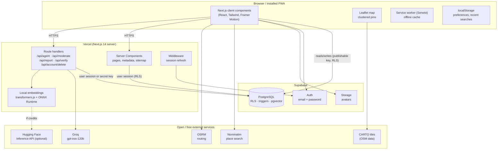

**Two ways to reach the database.** Ordinary reads and writes (loading restrooms, adding a review, voting) go **directly from the browser to Supabase** with the publishable key. They are safe because **Row Level Security (RLS)** and column grants in PostgreSQL decide what each user may do. Operations that need secrets or extra trust (the AI assistant, AI moderation, account deletion, writing badges and embeddings) go through **Next.js route handlers**, which run on the server and may use the server-only secret key.

## 5.2 Technology stack

| Layer | Technology | Role |
| --- | --- | --- |
| Framework | Next.js 14 (App Router), React 18, TypeScript (strict) | Pages, server rendering, API routes |
| Styling | Tailwind CSS, shadcn/ui (Radix UI), Framer Motion, Lucide | Accessible components, animations, icons |
| Map | Leaflet, react-leaflet, CARTO Voyager / Dark Matter tiles | Map display; pins grouped into count bubbles when zoomed out |
| Database | Supabase PostgreSQL, pgvector (HNSW index) | Data, rules (triggers), vector search |
| Auth and storage | Supabase Auth, Supabase Storage | Accounts, sessions (cookies), profile photos |
| Routing | OSRM on routing.openstreetmap.de (foot and car profiles) | Directions and turn-by-turn steps |
| Search | Nominatim | Place names to coordinates, coordinates to addresses |
| AI | Groq (`gpt-oss-120b`), all-MiniLM-L6-v2 (Hugging Face API or transformers.js) | Assistant, moderation, embeddings |
| PWA | Serwist | Service worker, precaching, offline pages |
| Hosting | Vercel (free tier), Web Analytics, Speed Insights | Builds, deployment, CDN, metrics |

## 5.3 Application structure

```
app/           Routes (App Router): pages, API route handlers, sitemap, robots, OG image
components/    UI by feature: map, restroom, add, agent, navigation, moderation, profile, settings, ...
hooks/         Client hooks: restroom store, geolocation, navigation, i18n, theme
lib/           Data access, AI (agent, RAG, embeddings, moderation), routing, OSM, i18n dictionaries
types/         Shared TypeScript types, including the hand-written database types
supabase/      SQL migrations 0001–0007
scripts/       Seeding, OpenStreetMap import, renaming, embedding generation
docs/          API, database, component and thesis documentation
```

The codebase has about 21,800 lines of TypeScript, 1,700 lines of SQL, 14 pages, 5 API routes, 91 React components and 13 custom hooks.

### Pages

| Route | Purpose |
| --- | --- |
| `/` | Map with clustered restroom pins, search, "near me", filters, AI assistant |
| `/list` | Restrooms sorted by distance, with filters |
| `/restroom/[id]` | Details, amenities, reviews, verification, reporting, navigation |
| `/add` | Add a restroom in four steps |
| `/city/[slug]` | Restrooms in one city (for search engines and sharing) |
| `/profile`, `/leaderboard` | Points, level, badges, contributions; top contributors |
| `/settings` | Account, language, theme, AI assistant toggle, export data, delete account |
| `/moderation` | Moderator dashboard (moderators and admins only) |
| `/auth/login`, `/auth/signup` | Authentication |
| `/about`, `/privacy`, `/terms` | Information, coverage, credits, legal pages |

## 5.4 Data model

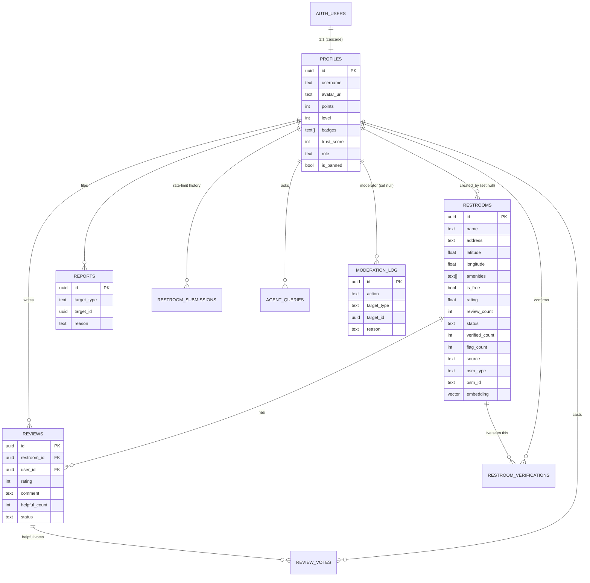

Key design points:

- **Business rules live in the database.** Seventeen triggers and 28 functions maintain ratings, points, levels, statuses, counts and the trust score, and enforce rate limits and bans. Because PostgreSQL enforces the rules, a user cannot bypass them by calling the API directly instead of using the app.
- **Row Level Security** is enabled on every table (31 policies). For example, rejected restrooms are visible only to their author and moderators, and the moderation log is visible only to moderators.
- **Column grants** limit what users can write: a user can edit a restroom's name, address and amenities, but not its rating, status, points or embedding.
- **Data provenance:** `source` marks each restroom as `user`, `seed` or `osm`. Imported rows keep their OSM id (unique), so re-running the import never creates duplicates.
- **Deletion semantics:** deleting an account cascades to the profile, reviews, votes, reports and AI usage history, while the user's restrooms remain with `created_by = NULL`, so the community does not lose them.

## 5.5 Key processes

### 5.5.1 Browsing the map

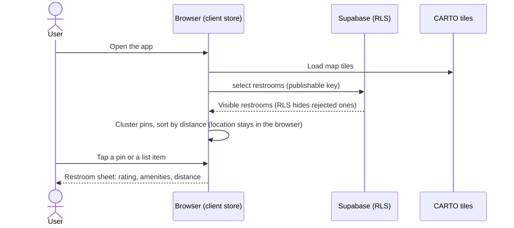

### 5.5.2 AI assistant (Retrieval-Augmented Generation)

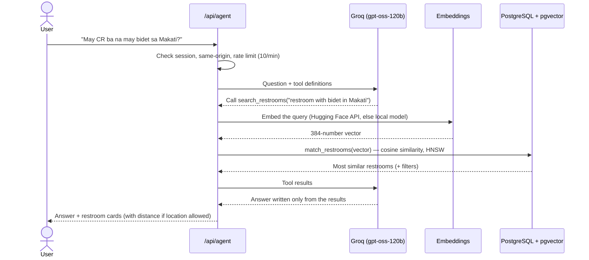

If embeddings are unavailable, the search falls back to keyword matching. "Near me" questions skip semantic search and sort by distance.

### 5.5.3 Adding a restroom, with moderation

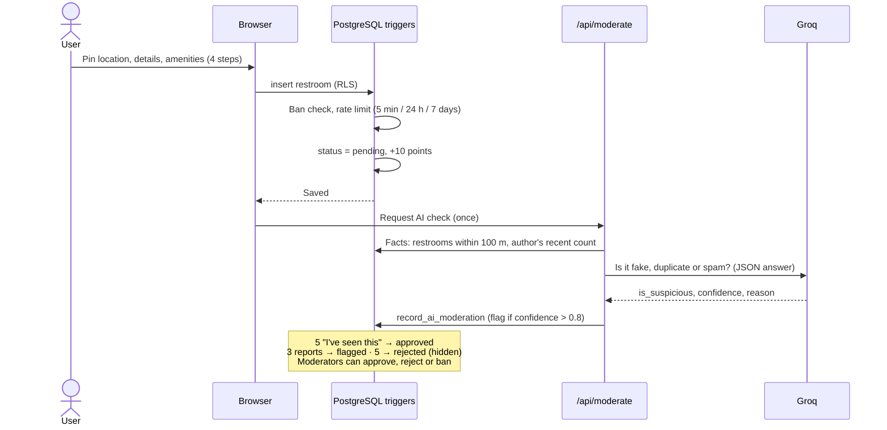

### 5.5.4 Navigation

The browser requests a route from OSRM (walking or driving profile) and draws it on the map. During navigation, the device's GPS position is followed, the next step is shown and spoken with the Web Speech API in Tagalog or English, and a new route is requested if the user goes off the route. Directions use the device's location only and are not stored on the server.

### 5.5.5 Account deletion

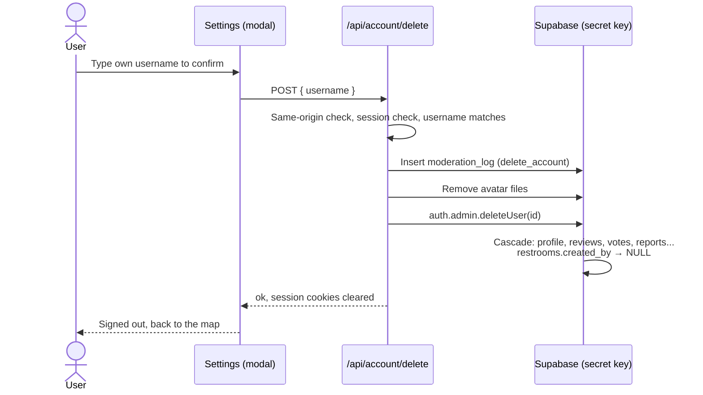

## 5.6 Security architecture

| Layer | Measure |
| --- | --- |
| Transport | HTTPS only; HSTS header |
| Browser | Security headers: `X-Frame-Options: DENY`, `X-Content-Type-Options: nosniff`, `Referrer-Policy`, `Permissions-Policy` |
| CSRF | Session cookies are `SameSite=Lax`; every POST API route also rejects requests whose `Origin` is another site |
| Authentication | Supabase Auth; sessions refreshed in middleware; server code validates the user with the Auth server (`getUser()`), not just the cookie |
| Authorization | Row Level Security on every table, column-level grants, role checks (`user`, `moderator`, `admin`) inside SECURITY DEFINER functions |
| Abuse prevention | Database rate limits, report limits, bans, AI rate limit (10 questions per minute) |
| Input validation | zod schemas on every API route; CHECK constraints in the database (lengths, ranges, allowed values) |
| Secrets | The secret key is only read on the server (no `NEXT_PUBLIC_` prefix) and never committed |
| AI safety | The assistant may only answer from tool results; tool arguments are validated before use |

## 5.7 Cross-cutting concerns

**Internationalization.** All text lives in two dictionaries, `tl.ts` (Tagalog) and `en.ts` (English). The English dictionary is typed against the Tagalog one, so the build fails if a text is missing in either language. The language is chosen from a cookie, or on the first visit from the browser's `Accept-Language` header, so server-rendered pages appear in the right language without flicker.

**PWA and offline.** Serwist precaches the application shell and caches pages and assets at runtime. The web app manifest provides maskable icons and theme colours, so the app can be installed to the home screen.

**SEO and sharing.** Every page has its own title, description, canonical URL and Open Graph and Twitter card metadata. The dynamic sitemap lists the public pages, the five city pages and every visible restroom (870 URLs). Restroom pages include JSON-LD structured data (`PublicToilet`).

**Accessibility.** Every input has a label and every icon button has an accessible name. Modals trap focus, colour contrast meets WCAG AA in light and dark mode, and layouts are tested at 375 px and at desktop zoom levels up to 200%.

## 5.8 Deployment architecture

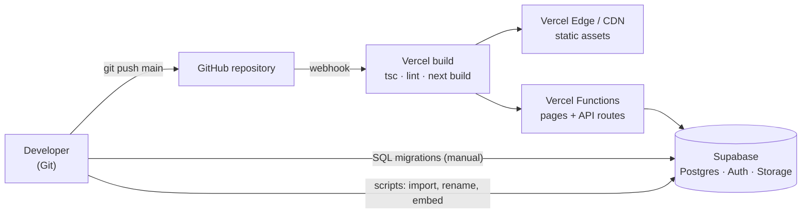

- **Continuous deployment:** every push to `main` is built and deployed by Vercel within about two minutes.
- **Database migrations** are versioned SQL files (`0001` to `0007`), each safe to re-run, applied in the Supabase SQL Editor.
- **Data scripts** (OSM import, renaming, embedding generation) run from the developer's machine with the secret key.
- **Cost:** all services run on free tiers. The running cost of the system is ₱0.

## 5.9 Architectural decisions

| Decision | Alternatives considered | Reason |
| --- | --- | --- |
| Leaflet + OSM + CARTO tiles | Google Maps, Mapbox | Free at any scale within fair use, no API key, open data |
| OSRM public server | Google Directions, GraphHopper | Free, no key, separate walking and driving profiles |
| Rules in PostgreSQL (triggers, RLS) | Rules in the API layer | Cannot be bypassed; one source of truth for app, API and scripts |
| Browser talks directly to Supabase for ordinary data | Every request through a custom API | Less server code and latency; RLS makes it safe |
| pgvector inside the same database | A separate vector database | One system to run and back up; joins with restroom data |
| Groq with an open-weight model | OpenAI or Anthropic APIs | Free tier, fast, reliable tool calling |
| Local embeddings fallback (transformers.js) | Paying for Hugging Face credits | Free; same model, so vectors stay compatible (cosine similarity ≈ 0.99 between the two sources) |
| PWA | Native Android/iOS apps | One codebase, no app store, small download |

## 5.10 Scalability considerations

- **Database:** indexed queries, an HNSW index for vectors, and trigger-maintained counters (instead of counting on every read) keep queries fast as the data grows.
- **Client data loading:** the map currently loads all visible restrooms in one request, which suits the current 859 rows. Supabase returns at most 1,000 rows per request by default, so **before the database passes 1,000 restrooms, the map must load data by area (bounding box of the visible map) or in pages.** Otherwise the oldest restrooms would silently be left out.
- **External services:** the public Nominatim and OSRM servers have usage limits and no guarantee. At higher traffic they should be self-hosted (both are open source) or replaced with paid plans.
- **AI:** Groq's free-tier rate limits cap how many questions can be answered per minute. The per-user limit of 10 questions per minute protects that quota.

---

# Chapter 6. Implementation

This chapter describes how the system was built, phase by phase, then explains the main features in more detail, and ends with code statistics. The architecture behind these features is described in Chapter 5.

## 6.1 Phase-by-phase implementation

The numbers of changed files and lines come from the Git commit of each phase. Phase 1 includes the generated `package-lock.json`, which accounts for most of its lines.

| Phase | Implemented | Main files added | Files changed | Lines added / removed |
| --- | --- | --- | --- | --- |
| 1. Scaffold + PWA | Next.js 14 project, TypeScript strict, Tailwind, shadcn/ui, app layout (header, bottom navigation), Serwist service worker, web manifest | `app/layout.tsx`, `components/layout/*`, `app/sw.ts`, `public/manifest.json` | 37 | +8,831 / −0 |
| 2. Map + mock pins | Leaflet map, "near me" with browser geolocation, restroom bottom sheet, star rating, mock data | `components/map/RestroomMap.tsx`, `NearMeButton.tsx`, `RestroomSheet.tsx`, `hooks/use-geolocation.ts` | 13 | +701 / −9 |
| 3. UI + real icons + filters | List page sorted by distance, restroom detail page with mini-map, amenity icons, filters, share button | `app/list`, `app/restroom/[id]`, `RestroomList.tsx`, `RestroomFilters.tsx`, `lib/distance.ts` | 24 | +910 / −82 |
| 4. Add + profile | Four-step add-restroom form with a location picker and reverse geocoding, profile page, client restroom store | `app/add`, `AddRestroomForm.tsx`, `LocationPicker.tsx`, `lib/geocode.ts`, `lib/restroom-store.ts` | 27 | +1,721 / −169 |
| 5. Supabase + auth | PostgreSQL schema with RLS, email/password authentication, session middleware, error pages, upload of locally saved restrooms | `supabase/migrations/0001_init.sql`, `app/auth/*`, `lib/supabase/*`, `middleware.ts` | 49 | +3,111 / −368 |
| 6. Ratings + reviews | Reviews (1–5 stars and a comment), one per user per restroom, rating trigger | `0002_reviews.sql`, `ReviewForm.tsx`, `ReviewList.tsx`, `lib/reviews/queries.ts` | 14 | +1,168 / −36 |
| 7. Navigation | OSRM walking and driving routes, route layer, turn-by-turn panel, GPS following, re-routing, spoken instructions | `lib/routing.ts`, `lib/voice.ts`, `NavigationPanel.tsx`, `hooks/use-navigation.ts` | 21 | +3,905 / −47 |
| 8. AI agent | Groq tool-calling agent, RAG with pgvector and embeddings, chat UI, per-device on/off, usage stats | `app/api/agent/route.ts`, `lib/ai/*`, `AgentChat.tsx`, `0003_embeddings.sql` | 21 | +1,956 / −19 |
| 9. Modern UI | CARTO Voyager and Dark Matter tiles, dark mode, animations, modal and button system, unsaved-changes guard | `components/ui/Modal.tsx`, `ConfirmModal.tsx`, `AnimatedButton.tsx`, `lib/theme.ts` | 69 | +3,180 / −834 |
| 10. Gamification + search | Points, levels, badges, leaderboard, place search (Nominatim), onboarding, settings, About, Privacy and Terms pages, OG image; **English and Tagalog** support (separate commit) | `0004_gamification.sql`, `lib/badges.ts`, `lib/levels.ts`, `Leaderboard.tsx`, `lib/i18n/*` | 50 + 99 | +3,257 / −166 and +2,947 / −937 |
| 11. Anti-spam + moderation | Statuses, reports, verification, rate limits, trust score, bans, AI moderation, moderator dashboard | `0005_moderation.sql`, `app/api/{moderate,report,verify}`, `app/moderation`, `lib/ai/moderation.ts` | 37 | +3,604 / −52 |
| 12. OSM import + launch | Overpass import of 585 Metro Manila toilets, pin clustering, sitemap, robots.txt, JSON-LD, security headers, CSRF check, analytics, documentation | `lib/osm.ts`, `scripts/import-osm.ts`, `0006_osm.sql`, `ClusteredMarkers.tsx`, `app/sitemap.ts` | 39 | +1,342 / −59 |
| Branding | Logo, app and maskable icons, paper-map background, Fredoka wordmark, poster-style login | `components/brand/MapDecorations.tsx`, `public/patterns/*`, `AuthCard.tsx` | 20 + 21 | +214 / −89 and +278 / −102 |
| 13. Growth + community | Four more cities, landmark-based names, city pages, account deletion, local embeddings, login layout for desktop zoom | `lib/cities.ts`, `lib/osm-naming.ts`, `app/city/[slug]`, `app/api/account/delete`, `lib/ai/local-embeddings.ts`, `0007_account_deletion.sql` | 28 | +2,218 / −172 |

**Verification per phase.** Every phase passed the type check, lint and production build before it was committed. Phases 1 to 10 were also checked in the browser at a 375-pixel viewport, but those checks were not saved as reusable scripts. From Phase 11 on, the checks were written as automated scripts that were run again after each later phase (Chapter 7).

## 6.2 Key features

### 6.2.1 Map and list

- **Map:** Leaflet with CARTO tiles (light: Voyager; dark: Dark Matter). Because hundreds of pins on one screen would be slow and unreadable, nearby pins are grouped into **count bubbles** with a grid-clustering component written for the project (`ClusteredMarkers.tsx`), without an extra plugin. Tapping a bubble zooms in.
- **List:** restrooms sorted by straight-line (Haversine) distance from the user, 40 at a time with a "show more" button, and filters for free, bidet, wheelchair access, tissue, soap and air-conditioning.
- **Search:** place search through Nominatim (e.g., "SM Megamall"), with recent searches stored on the device.
- **Restroom page:** status badge, rating, price, address, distance, a mini-map, amenities (missing ones shown struck through), community verification, reviews, report and share buttons, and the OSM credit for imported restrooms.


### 6.2.2 AI assistant

The assistant (`lib/ai/agent.ts`) runs an agent loop:

1. The question, the recent conversation and three tool definitions are sent to `gpt-oss-120b` on Groq.
2. The model calls a tool. `search_restrooms` runs a semantic search: the query, which the model writes in English with full place names, is embedded and compared with the restroom embeddings in PostgreSQL (`match_restrooms`). Filters (free, amenities) and sorting by distance are applied afterwards. `get_distance` and `start_navigation` let the assistant answer "how far" questions and open directions.
3. The model writes the answer **only from the tool results**, in the user's language, and the app shows the matching restrooms as cards.

Embeddings are produced by `generateEmbedding()`. It uses the Hugging Face Inference API when the account has credits, and otherwise runs the same model locally with transformers.js. After a "no credits" response, the API is skipped for 30 minutes. Each restroom's text is built by `restroomToDocument()` (name, description, address with abbreviations expanded, such as "BGC" to "Bonifacio Global City", amenities and price). When an embedding cannot be made at all, the search falls back to keyword matching.

Requests are limited to 10 per minute per user, and the assistant can be turned off per device in Settings.


### 6.2.3 Navigation

- Routes come from the public OSRM servers at routing.openstreetmap.de, which provide separate **foot** and **car** profiles.
- The route is drawn on the map, and a panel shows the travel time, distance, arrival time and a list of steps. OSRM maneuvers are translated into Tagalog or English by `lib/routing-translations.ts`.
- During navigation the app follows the GPS position (`watchPosition`), advances the steps, speaks each instruction with the Web Speech API (`lib/voice.ts`), detects when the user is off the route and requests a new one, and announces arrival.


### 6.2.4 Gamification

| Action | Points |
| --- | --- |
| Add a restroom | +10 |
| Write a review | +5 |
| Receive a "helpful" vote on your review | +1 |

| Level | Name | Points needed |
| --- | --- | --- |
| 1 | Newbie | 0 |
| 2 | Explorer | 50 |
| 3 | Scout | 200 |
| 4 | Expert | 500 |
| 5 | Legend | 1,000 |

Six badges (`first-cr`, `reviewer`, `explorer`, `top-reviewer`, `helpful`, `legend`) reward milestones. Points and levels are maintained by the database trigger `award_points()`. Deleting a restroom or review takes its points back, so points cannot be farmed by adding and deleting. A leaderboard lists the top contributors, excluding banned users.

### 6.2.5 Anti-spam and moderation

The moderation model works in layers. Each layer is enforced in PostgreSQL (`0005_moderation.sql`):

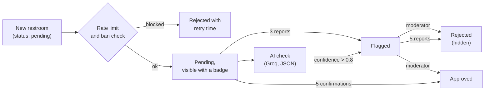

| Rule | Value |
| --- | --- |
| New restrooms per user | 1 per 5 minutes, 5 per 24 hours, 20 per 7 days (rolling windows) |
| Reports per user | 10 per 24 hours, one per item |
| Flag / hide thresholds | 3 reports flag an item, 5 hide it |
| Approval threshold | 5 "I've seen this" confirmations from other users |
| Trust score | +2 per confirmation of your restrooms, +10 while one is approved, −20 while one is rejected |
| Bans | Hide all of the user's content and block every write; admins cannot be banned, and only admins can ban moderators |

The AI check (`/api/moderate`) gives the model facts that the server computes itself, namely the restrooms within 100 m and how many restrooms the author added in the last 24 hours, and asks for a JSON verdict. Moderators see flagged restrooms, open reports, banned users and AI-unchecked restrooms in a dashboard at `/moderation`, and every action is written to `moderation_log`.

### 6.2.6 English and Tagalog

All interface text is stored in two dictionaries (`lib/i18n/dictionaries/tl.ts` and `en.ts`, about 930 lines each). The type of the English dictionary is derived from the Tagalog one, so a missing or misspelled key is a **compile-time error**. The language is saved in a cookie, so server-rendered pages appear in the right language on first load. On a first visit, it is detected from the browser's `Accept-Language` header. Error messages from the database, route-planning instructions and spoken directions are translated as well.

### 6.2.7 Data import and naming

- `scripts/import-osm.ts --city=<slug>` fetches `amenity=toilets` for a city from the Overpass API, trying three public servers with retries. It drops private, staff-only and disused toilets and skips toilets within 30 m of an existing restroom with a similar name. It fills missing addresses with Nominatim and inserts the rows with an upsert on `(osm_type, osm_id)`.
- Unnamed or generically named toilets ("Toilet", "Male Urinal", "men/women") get a descriptive name from `lib/osm-naming.ts`. A landmark within 25 m is used first (except food stalls, which are often right next to a mall's or park's CR). Otherwise the nearest suitable large landmark within a radius that depends on its kind (for example, 300 m for a mall, 800 m for an airport) is used. If there is none, the street and barangay are used. Duplicate names get the street in parentheses or a number. Examples: "CR sa Rizal Park", "CR sa Petron (Rizal Avenue)", "CR sa Ateneo de Manila University (Parade Loop)".

### 6.2.8 Accounts and privacy features

Settings lets users change their username and photo, language, theme and the AI-assistant toggle, export their data as JSON, clear the data saved on the device, and permanently delete their account. Deletion requires typing the username, which the server checks again. It is logged, removes the avatar files, and deletes the authentication user; the database cascade then removes the profile and the user's reviews, votes and reports, and keeps their restrooms without their name.

## 6.3 Code statistics

Counted from the files tracked in Git, October 2026.

| Area | Files | Lines |
| --- | --- | --- |
| `app/` (pages, API routes) | 35 | 2,344 |
| `components/` | 92 | 10,791 |
| `lib/` (logic, data access, AI, i18n) | 58 | 6,628 |
| `hooks/` | 13 | 954 |
| `types/` | 5 | 464 |
| `scripts/` | 4 | 475 |
| **TypeScript total** | **207** | **≈21,700** |
| SQL migrations | 7 | 1,712 |

| Measure | Count |
| --- | --- |
| Pages (routes) | 14 |
| API route handlers | 5 |
| React components (`.tsx`) | 91 |
| Custom hooks | 13 |
| Database triggers / functions / RLS policies | 17 / 28 / 31 |
| Runtime dependencies / development dependencies | 32 / 10 |
| Files tracked in Git | 244 |
| Commits | 19 |
| Automated checks in the final test run | 251 (247 passed; see Chapter 7) |

The i18n dictionaries account for about 1,900 of the `lib/` lines.

---

# Chapter 7. Testing

This chapter describes how Poopipoo was tested, the results of the final test run, and what the tests do not cover.

## 7.1 Testing strategy

Testing focused on the risks that matter most for a public, crowdsourced app:

1. **Data integrity and abuse:** the database rules (rate limits, moderation, Row Level Security) must hold even against direct API calls.
2. **User flows:** the main tasks must work end to end in a real browser.
3. **Accessibility and mobile layout:** the app must be usable at 375 px, with assistive technologies, and in light and dark mode.
4. **Production behaviour:** what works locally must also work on the deployed site.

| Level | Used? | How |
| --- | --- | --- |
| Static analysis | Yes | TypeScript strict mode (`tsc --noEmit`), ESLint (`next lint`), production build (`next build`) on every phase |
| Unit tests | No | No unit-test framework was set up. Pure functions (distance, levels, naming, address parsing) were checked through the end-to-end and database suites and with one-off scripts during development |
| Integration tests | Yes | Database suite: calls the Supabase REST API as temporary users with different roles and checks every rule |
| End-to-end (E2E) tests | Yes | Scripts that drive headless Microsoft Edge (Chromium) through the Chrome DevTools Protocol |
| Accessibility tests | Yes | axe-core 4.10.2 injected into each page; WCAG 2.0 A/AA and WCAG 2.1 AA rule sets |
| Performance tests | Yes | Production bundle sizes; cold page loads with network throttling (see 7.5) |
| Security tests | Yes | CSRF (cross-site POST), RLS (reading or writing other users' data), privilege escalation (setting one's own role or points), secrets not exposed |
| Usability tests with users | No | Not yet done (see Chapter 9) |

### Test environment

- **Local:** a production build (`next build` + `next start`) on port 3123, connected to the real Supabase project.
- **Production:** https://poopipoo.vercel.app after each deploy.
- **Browser:** headless Microsoft Edge (Chromium), controlled through the Chrome DevTools Protocol.
- **Viewports:** 375 × 812 (phone, the main target), 1440 × 900 (desktop), and desktop zoom levels from 100% to 200%, simulated by smaller CSS viewports.
- **Test data:** every script creates its own temporary users and restrooms and deletes them at the end, so the tests can run against the live database without leaving data behind.

**Note on the test scripts.** The test scripts were written and run during development in a separate working folder; they are **not yet in the repository**. This means the tests cannot currently be re-run by someone else from the repository alone. Moving them into the repository with a test runner is recommended future work (Chapter 9).

## 7.2 Test suites and results

Final run, October 2026.

| Suite | What it covers | Checks | Passed |
| --- | --- | --- | --- |
| Database rules | Rate limits, verification and report thresholds, trust score, bans, RLS, column grants, moderation functions | 63 | **63** |
| Phase 11 UI | AI moderation route, rate-limit countdown, verify, report, profile, moderator dashboard, ban flow, at 375 px | 29 | **29** |
| Phase 12 | robots.txt, sitemap, security headers, CSRF, JSON-LD, canonical URLs, OSM attribution, pin clustering, list paging, axe at 375 and 1440 px, keyboard focus, 3G load, offline mode | 42 | **42** |
| Brand and theme | Icons, manifest, favicon, OG image, header logo, background pattern, axe and horizontal scroll on 7 pages in light and dark mode | 41 | **41** |
| Phase 13 pages | City page titles in both languages, canonical and Open Graph tags, unknown city, sitemap, site description, axe at 375 and 1440 px in light and dark, city page content and links | 34 | **34** |
| Account deletion | API without a session, cross-site request, wrong username, modal focus and labels, axe with the modal open, full deletion and every cascade | 18 | **18** |
| Login at desktop zoom | Every part of the login and signup forms reachable at 8 viewport sizes | 20 | **20** |
| Login fits without scrolling | Stricter check: the whole form visible without scrolling at 100–175% zoom | 4 | 0 |
| **Total** | | **251** | **247** |

The six suites listed in the original test plan (database, Phase 11, Phase 12, brand, Phase 13 and deletion) account for **227 checks, all passed**. Including the 20 reachability checks of the zoom suite, **247 checks passed**.

The four stricter zoom checks are not counted as failures of the requirement ("everything stays visible and usable when zooming"), because every element remains reachable by scrolling. The login form fits without scrolling up to 150% zoom, while the longer signup form needs scrolling from 125% zoom upward. This is recorded as a known limitation.

### Examples of individual checks

**Database rules (selected):**

| Check | Expected result |
| --- | --- |
| Second restroom within 5 minutes | Error "Rate limit exceeded" with the retry time |
| Sixth restroom in 24 hours | Blocked until the oldest one is 24 hours old |
| User sets their own role or trust score | Refused (column grants) |
| User verifies their own restroom | Refused |
| 5th confirmation | Restroom becomes `approved`; author's trust score +10 |
| 3rd report / 5th report | `flagged` / `rejected` (hidden from guests and other users, visible to the author and moderators) |
| 11th report in 24 hours | Error "Report limit exceeded" |
| AI flag with confidence 0.75 / 0.95 | Not flagged / flagged and logged |
| Moderator bans a moderator | Refused (only admins can) |
| Banned user adds, reviews, votes or reports | Refused with the ban reason |

**Account deletion (all 18):** a request without a session returns 401, a cross-site request returns 403, and a wrong username returns 400. The modal opens with the text field focused and labelled and the delete button disabled, and axe finds no violations. A wrong name keeps the button disabled; the matching name, in any letter case, enables it. After deletion: the user is redirected with a confirmation; the auth user, profile, review and helpful vote are gone; the restroom remains with no author; the avatar files are removed; `moderation_log` has a `delete_account` entry; the restroom's review count is recalculated; and the user is signed out. Before migration 0007 was applied, the same suite confirmed that a failed deletion leaves the account fully intact and leaves no log entry.

## 7.3 Accessibility

axe-core 4.10.2 was run with the WCAG 2.0 A, WCAG 2.0 AA and WCAG 2.1 AA rule sets on these pages: map, list, restroom (seeded and imported), profile, leaderboard, settings, about, privacy, login, signup and the city pages. It ran at 375 px and 1440 px, in light and dark mode, and on the settings page with the account-deletion modal open. **The final run reported no violations.** The add-restroom form, the terms page and the moderation dashboard were checked for layout and labels by the UI suites but were not part of the final axe run.

One issue found and fixed during development was insufficient colour contrast of grey text on grey backgrounds (measured 4.3:1, below the required 4.5:1). Manual and scripted checks also covered:

- keyboard navigation: Tab reaches every link and button with a visible focus outline;
- focus management: modals move focus inside and keep it there; destructive dialogs focus "Cancel" or a text field first;
- labels: every form field has a label and every icon button an accessible name;
- no horizontal scrolling at 375 px on any page.

Automated tools cannot detect every accessibility problem; testing with screen-reader users is recommended (Chapter 9).

## 7.4 Responsive design

| Viewport | Coverage |
| --- | --- |
| 375 × 667 and 375 × 812 (phone) | All pages; no horizontal scrolling; bottom navigation does not cover content |
| 1440 × 900 (desktop) | All pages; centred layouts; login shown in two columns |
| Desktop zoom 125%, 150%, 175%, 200% | Login and signup fully reachable. Two-column layout on wide but short windows; the logo stays visible while the form scrolls |

## 7.5 Performance

### Bundle size

From the production build (`next build`), the JavaScript loaded on first visit:

| Route | First-load JS |
| --- | --- |
| `/` (map) | 318 kB |
| `/restroom/[id]` | 298 kB |
| `/list` | 272 kB |
| `/city/[slug]` | 174 kB |
| `/about` | 105 kB |
| Shared by all pages | 89.5 kB |

The map page is above the 200 kB target set during development. Most of it is the Supabase client, React DOM and the animation library; Leaflet and the AI chat are loaded only when needed.

### Page loads on a slow network

Cold loads of the production site were measured in a fresh incognito browser context for each run (empty cache, no service worker), at 375 px. Each value is the median of three runs. "Content ready" means the main content is visible: pins on the map, at least 10 list items, or the page heading. "Fast 3G" is the Chrome DevTools preset (1.44 Mbps down, 675 kbps up, 562.5 ms round-trip time).

| Page | Network | First Contentful Paint | Content ready | Transferred | JavaScript |
| --- | --- | --- | --- | --- | --- |
| `/` (map) | Unthrottled | 0.6 s | 1.8 s | 1,011 kB | 408 kB |
| `/` (map) | Fast 3G | 1.6 s | 6.1 s | 1,012 kB | 408 kB |
| `/list` | Unthrottled | 0.6 s | 1.6 s | 566 kB | 367 kB |
| `/list` | Fast 3G | 1.7 s | 5.9 s | 568 kB | 367 kB |
| `/restroom/[id]` | Unthrottled | 1.3 s | 1.9 s | 607 kB | 428 kB |
| `/restroom/[id]` | Fast 3G | 1.8 s | 2.1 s | 504 kB | 370 kB |
| `/city/cebu` | Fast 3G | 1.7 s | 1.8 s | 440 kB | 296 kB |
| `/about` | Fast 3G | 1.6 s | 1.7 s | 433 kB | 292 kB |

Transferred sizes are compressed. The map page's total includes map tiles and the restroom data.

On a slow 3G connection, server-rendered pages (restroom, city, about) show their content in about 2 seconds, while the map and list take about 6 seconds because they first download the JavaScript and the data for all 859 restrooms. After the first visit, the service worker serves cached assets, and a page that was visited before opens even without a connection (checked in the Phase 12 suite).

## 7.6 Security testing

| Threat | Test | Result |
| --- | --- | --- |
| Cross-site request forgery | POST to each API route with a foreign `Origin` header | Refused (403) |
| Reading hidden data | Guest and other users request rejected restrooms, other users' reports and the moderation log | Not returned (RLS) |
| Privilege escalation | User sets their own role, trust score, points or a restroom's status | Refused (column grants) |
| Abuse | Rapid restroom submissions, mass reporting, banned user writing | Refused by the database rules |
| Unauthenticated API use | Assistant and deletion APIs without a session | 401 |
| Exposed secrets | All 42 JavaScript chunks served by nine production pages (1.4 MB) searched for the values and the names of the three server-only keys | None found. The only match of the prefix `sb_secret_` is supabase-js's own check of the key type |
| Security headers | Response headers checked on production | HSTS, X-Frame-Options, nosniff, Referrer-Policy and Permissions-Policy present |

## 7.7 Limitations of the testing

- There are no unit tests, and the test scripts are not yet in the repository.
- Only a Chromium-based browser was used. Firefox and Safari (including iOS Safari, where PWA support differs) were not tested.
- Real phones were not part of the automated tests, which emulate mobile viewports and touch in a desktop browser.
- The AI assistant's answer quality was checked with sample questions, not measured systematically (for example, precision of the returned restrooms over a set of test questions).
- No load testing was done; behaviour under many simultaneous users is unknown, and the free tiers of the external services would be the first limit.
- No usability study with target users has been done yet.

---

# Chapter 8. Results and Discussion

This chapter presents the results of the project against its objectives, the measured characteristics of the system and its data, a comparison with existing applications, and a discussion of what worked and what did not.

## 8.1 Achievement of the objectives

| # | Objective (Chapter 2) | Result | Status |
| --- | --- | --- | --- |
| 1 | Import 500+ restrooms from OpenStreetMap | 829 imported across 5 cities (859 total with 30 seeded) | Achieved (166% of target) |
| 2 | AI agent with Groq and Hugging Face | Tool-calling assistant with RAG; 859 of 859 restrooms embedded; works when the Hugging Face API has no credits (local model) | Achieved |
| 3 | Free navigation with OSRM | Walking and driving routes, bilingual turn-by-turn instructions, spoken guidance, re-routing | Achieved |
| 4 | Gamification system | Points, 5 levels, 6 badges and a leaderboard, all computed in the database | Achieved |
| 5 | Anti-spam and moderation | Rate limits, reports, verification, AI moderation, trust score, bans, dashboard; 63 of 63 database rule checks passed | Achieved |
| 6 | English and Tagalog | Complete bilingual interface, checked at compile time | Achieved |
| 7 | Free deployment on Vercel | Live at https://poopipoo.vercel.app; running cost ₱0 | Achieved |

All seven specific objectives were met. The general objective, a free, crowdsourced and AI-assisted restroom finder for the Philippines, is met in the sense that the system exists, is publicly available, and is seeded with data. Whether it becomes truly *crowdsourced* depends on community adoption, which has not started yet (see 8.5).

## 8.2 The restroom data

### Coverage by city

| City (area) | Restrooms | From OSM | Seeded | Shown as free |
| --- | --- | --- | --- | --- |
| Metro Manila | 615 | 585 | 30 | 589 |
| Cebu (incl. Mandaue, Lapu-Lapu) | 91 | 91 | 0 | 87 |
| Davao | 74 | 74 | 0 | 71 |
| Iloilo | 64 | 64 | 0 | 64 |
| Bacolod | 15 | 15 | 0 | 15 |
| **Total** | **859** | **829** | **30** | **826** |

### Naming

Of the 829 toilets imported from OpenStreetMap, **821 (99%) had no specific name**: they were either unnamed or had a generic name such as "Toilet" or "men/women". The naming algorithm (Section 6.2.7) gave all of them a descriptive name:

| Name based on | Count | Share |
| --- | --- | --- |
| A nearby landmark or a place in the address ("CR sa Rizal Park") | 773 | 94% |
| Street and barangay ("CR sa Taft Avenue, Malate") | 48 | 6% |

The remaining 8 imported toilets kept their real OSM names (e.g., "Hel-Loo", "Pay Lounge").

### Amenity information

| Amenity | Restrooms tagged |
| --- | --- |
| `free` tag (no fee recorded) | 819 |
| Wheelchair accessible | 85 |
| Toilet paper | 34 |
| Soap | 25 |
| Baby changing | 14 |
| Bidet | 13 |
| Air-conditioned | 12 |
| Shower | 1 |

Only **114 of 859 restrooms (13%)** have any amenity recorded besides the price, and only 13 record a bidet. OpenStreetMap is good at telling *where* toilets are, but says little about *what they have*. This is exactly the information that community reviews and edits are meant to add, and it is the strongest argument for the crowdsourced part of the design.

## 8.3 System metrics

| Metric | Value | Source |
| --- | --- | --- |
| Restrooms / cities | 859 / 5 | Database |
| Restrooms with an embedding | 859 (100%) | Database |
| Sitemap URLs | 870 (11 pages + 859 restrooms) | Production `/sitemap.xml` |
| First-load JavaScript, map page | 318 kB | `next build` |
| Map page ready on Fast 3G / unthrottled | 6.1 s / 1.8 s | Section 7.5 |
| Server-rendered pages ready on Fast 3G | about 1.7–2.1 s | Section 7.5 |
| AI assistant response time | about 3–4 s per question | Production test |
| Semantic search (after the model is loaded) | about 160 ms per query | Local measurement |
| Vector storage | about 1.3 MB (859 × 384 × 4 bytes, before index) | Calculated |
| Total database size | *[to verify: Supabase Dashboard, Database usage]* | — |
| Automated checks passed | 247 of 251 (227 of 227 in the six main suites) | Chapter 7 |
| WCAG 2.1 AA violations (axe) | 0 | Chapter 7 |
| Development time | 4 days (5–8 October 2026), 19 commits | Git history |
| Monthly running cost | ₱0 (free tiers) | Service dashboards |

## 8.4 Comparison with existing applications

| Feature | Google Maps | Waze | Toilet-finder apps (SitOrSquat, Flush, OSM-based) | **Poopipoo** |
| --- | --- | --- | --- | --- |
| Main purpose | General maps and places | Driving navigation | Finding toilets | **Finding CRs in the Philippines** |
| Restroom-specific details (bidet, tissue, PWD, fee) | Limited (some accessibility info) | No | Some | **Yes, filterable** |
| Philippine coverage of restrooms | Incidental (places that have toilets) | No | Sparse | **859 in 5 cities** |
| Tagalog interface | Yes | Yes | No | **Yes** |
| Conversational search | Emerging AI features | No | No | **Yes, grounded in own data** |
| Walking directions | Yes | No (driving) | Usually via another app | **Yes, built in, with voice** |
| Community moderation | Yes | Yes | Basic | **Yes, enforced in the database** |
| Open data | No | No | Some (OSM-based ones) | **Yes, ODbL with attribution** |
| Install | App | App | App | **Web or PWA, no app store** |
| Cost to user | Free (ads, data) | Free (ads) | Free with ads / paid | **Free, no ads** |

Google Maps and Waze are far more mature and have vastly larger user bases, so Poopipoo does not compete with them as a general map. Its contribution is **focus**: the questions it answers ("Which CR near me is free and has a bidet?") are not first-class questions in the general apps, and the specialized toilet apps do not serve Philippine users in Tagalog or record Philippine amenities.

## 8.5 Discussion

### What worked

- **Seeding solved the cold start.** Importing OpenStreetMap data turned an empty map into one with 859 restrooms on the first visit, at no cost and with a clear license.
- **Rules in the database.** Putting points, rate limits and moderation thresholds in PostgreSQL triggers and RLS made them impossible to bypass and easy to test directly (63 database checks). It also kept the API layer small: ordinary reads and writes go directly from the browser to the database.
- **Grounded AI.** Because the assistant may only answer from tool results, it recommends real restrooms from the database instead of inventing them.
- **Graceful degradation.** Every external dependency has a fallback: semantic search falls back to keyword search; the Hugging Face API falls back to the local model; the Overpass import tries three servers; the PWA serves visited pages offline.
- **Zero cost.** Every service used has a free tier sufficient for the current scale.

### Problems encountered and how they were solved

| Problem | Cause | Solution |
| --- | --- | --- |
| Most imported toilets were called "Public CR" | 99% of OSM toilets have no specific name | Landmark-based naming algorithm (Section 6.2.7) |
| AI search stopped using embeddings | Hugging Face Inference API credits ran out (HTTP 402) | Same model run locally with transformers.js; vectors from both sources agree (cosine similarity ≈ 0.99) |
| AI assistant returned errors | The model began sending `null` for optional filters, which the provider's tool validation rejected | Tool schema accepts `null` ("any") |
| OpenStreetMap import failed at times | Public Overpass servers busy (HTTP 504/500) | Three mirrors, retries, per-city runs; failure detection moved before slow steps |
| Model download corrupted | An interrupted 23 MB download was saved without verification | Re-downloaded with resume and verified with its SHA-256 hash |
| Login form cut off when zoomed in on desktop | `overflow: hidden` on the page frame stopped the page from scrolling | Frame clips only sideways; two-column layout on wide but short windows |

### Limitations of the results

- **No community data yet.** At the time of writing, the database has one user profile (the author's) and no reviews. All restrooms come from OpenStreetMap or manual seeding. The contribution, gamification and moderation features are tested and working, but their effect on real users has not been observed.
- **Thin amenity data.** Only 13% of restrooms record any amenity, so amenity filters return few results until the community adds details.
- **Fee information is uncertain.** When OSM does not record a fee, the restroom is shown as free (826 of 859). Some are likely paid in practice.
- **Uneven coverage between cities,** from 615 restrooms in Metro Manila to 15 in Bacolod, following OSM's own coverage.
- **Map performance on slow networks.** The map takes about 6 seconds to show pins on a Fast 3G connection, mostly to download the JavaScript and all restroom data.
- **Scalability limit in data loading.** The map loads all restrooms in one request. Supabase returns at most 1,000 rows per request by default, so loading must be changed (by map area or in pages) before the database passes 1,000 restrooms.

---

# Chapter 9. Summary, Conclusions and Recommendations

## 9.1 Summary

This project set out to address the lack of a centralized, free and crowdsourced way to find public restrooms (CRs) in the Philippines. It produced **Poopipoo**, a mobile-first web application and PWA, live at https://poopipoo.vercel.app.

The system was built in thirteen incremental phases between 5 and 8 October 2026 with Next.js, TypeScript, Supabase, Leaflet and open map services, and with Groq-hosted open-weight language models for the AI features. At launch it holds **859 restrooms in five cities** (Metro Manila, Cebu, Davao, Iloilo and Bacolod), 829 of them imported from OpenStreetMap under the ODbL. Users can browse and filter restrooms, get walking or driving directions with spoken guidance, ask an AI assistant in Tagalog or English, add and review restrooms, earn points and badges, and report or confirm entries. Moderators have a dashboard. Users can export their data and delete their account.

The system passed 247 of 251 automated checks, including all 227 checks in the six main test suites, had no WCAG 2.1 AA violations in the final axe run, and runs entirely on free tiers.

## 9.2 Conclusions

The conclusions answer the specific problems stated in Chapter 2.

1. **Scalable database.** A PostgreSQL schema with business rules in triggers, Row Level Security on every table and column-level grants handles 859 restrooms and their related data consistently and securely, and the rules cannot be bypassed by calling the API directly. One limit was found in the client, not the database: the map loads all restrooms in one request, which must change before 1,000 restrooms.
2. **Natural-language AI agent.** Combining tool calling with retrieval-augmented generation over pgvector produces an assistant that answers questions in Tagalog or English using only real restrooms from the database. Running the embedding model locally removed the dependency on paid inference credits without changing the results (cosine similarity ≈ 0.99 with the API).
3. **Free navigation.** OSRM on OpenStreetMap data, together with the browser's geolocation and speech APIs, provides walking and driving directions with spoken, bilingual turn-by-turn guidance at no cost and without Google Maps.
4. **Gamification.** Points, levels, badges and a leaderboard were implemented, with points computed by the database so they cannot be farmed. Whether they actually increase contributions could not yet be measured, because the app has no community users yet.
5. **Moderation.** A layered approach (rate limits, community verification, report thresholds, AI screening, trust score, bans and a moderator dashboard), enforced in the database, blocked every abuse scenario that was tested.
6. **Multi-language support.** Deriving the English dictionary's type from the Tagalog one makes a missing translation a build error, which kept both languages complete across all features.
7. **Free deployment.** Vercel, Supabase and Groq free tiers, with open map services, run the complete system at a monthly cost of ₱0.

Overall, the project shows that a complete, useful public-utility application can be built and run by one developer on open data and free infrastructure. It also shows that **open data solves the "where" but not the "what"**: OpenStreetMap supplied the locations of 829 toilets but amenity information for only 13% of the restrooms, and almost none of them had a meaningful name. Collecting that missing information is the job of the community, which makes adoption the next and most important step.

## 9.3 Recommendations

### For the system

| Priority | Recommendation | Reason |
| --- | --- | --- |
| High | Load restrooms by visible map area (or in pages) | Required before the database passes 1,000 restrooms; also makes the map faster on slow networks |
| High | Move the test scripts into the repository with a test runner, add unit tests, and run them on every push (CI) | Makes the results in Chapter 7 reproducible and protects against regressions |
| High | Run a usability study with target users (commuters, PWDs, parents, tourists) | Validates the design and the gamification with real people |
| Medium | Test on Firefox and Safari, including iOS Safari as an installed PWA | Only Chromium was tested |
| Medium | Photo uploads for restrooms and reviews, with image moderation | Photos are the fastest way to judge a CR's condition |
| Medium | Real-time status reports ("no water", "closed", "long line") that expire after a few hours | The app cannot show the current state of a restroom |
| Medium | Reduce first-load JavaScript of the map page below 200 kB | Faster first visit on mobile data |
| Medium | Ask users to confirm or correct the fee and amenities of imported restrooms | 87% of restrooms have no amenity data, and fees are uncertain |
| Low | Add more cities (e.g., Baguio, Cagayan de Oro, Zamboanga, General Santos) | The import already supports new cities through `lib/cities.ts` |
| Low | Self-host OSRM and Nominatim if traffic grows | The public servers have usage limits |
| Low | A multilingual embedding model | Better semantic matching for Tagalog and other Philippine languages |

### For stakeholders

- **Local government units** could share their lists of public toilets as open data, and use the map's gaps and low ratings to plan facilities.
- **Establishments** could confirm and keep their own restroom details up to date.
- **The OpenStreetMap community** could receive improvements back: new or corrected toilets found through the app could be contributed to OSM, which benefits every app that uses it.

## 9.4 Future work

| Phase | Theme | Possible scope |
| --- | --- | --- |
| 14 | Community and data quality | Map loading by area; fee and amenity confirmations; real-time status reports; push notifications |
| 15 | Photos | Photo upload for restrooms and reviews; automatic image moderation; storage limits |
| 16 | Quality engineering | Tests in the repository with CI; unit tests; Firefox and Safari testing; performance budget |
| 17 | Reach | More cities; LGU and establishment data partnerships; contributing data back to OpenStreetMap |
| 18 | Sustainability | A way to cover costs above the free tiers that keeps the app free and ad-free for users, for example donations, grants, or opt-in "verified establishment" listings that do not change search ranking |

Monetization is listed last on purpose: the app's value to the public depends on it staying free, ad-free and neutral, so any revenue model should be judged against those principles first.

---

# Chapter 10. References

References follow APA 7th edition. Online documentation that changes over time includes the date it was retrieved.

## Books, papers and standards

Beck, K., Beedle, M., van Bennekum, A., Cockburn, A., Cunningham, W., Fowler, M., Grenning, J., Highsmith, J., Hunt, A., Jeffries, R., Kern, J., Marick, B., Martin, R. C., Mellor, S., Schwaber, K., Sutherland, J., & Thomas, D. (2001). *Manifesto for agile software development.* https://agilemanifesto.org/

Deterding, S., Dixon, D., Khaled, R., & Nacke, L. (2011). From game design elements to gamefulness: Defining "gamification". In *Proceedings of the 15th International Academic MindTrek Conference* (pp. 9–15). ACM. https://doi.org/10.1145/2181037.2181040

Douceur, J. R. (2002). The Sybil attack. In P. Druschel, F. Kaashoek, & A. Rowstron (Eds.), *Peer-to-peer systems (IPTPS 2002)* (Lecture Notes in Computer Science, Vol. 2429, pp. 251–260). Springer.

Goodchild, M. F. (2007). Citizens as sensors: The world of volunteered geography. *GeoJournal, 69*(4), 211–221. https://doi.org/10.1007/s10708-007-9111-y

Haklay, M. (2010). How good is volunteered geographical information? A comparative study of OpenStreetMap and Ordnance Survey datasets. *Environment and Planning B: Planning and Design, 37*(4), 682–703. https://doi.org/10.1068/b35097

Haklay, M., & Weber, P. (2008). OpenStreetMap: User-generated street maps. *IEEE Pervasive Computing, 7*(4), 12–18. https://doi.org/10.1109/MPRV.2008.80

Hamari, J., Koivisto, J., & Sarsa, H. (2014). Does gamification work? A literature review of empirical studies on gamification. In *Proceedings of the 47th Hawaii International Conference on System Sciences* (pp. 3025–3034). IEEE. https://doi.org/10.1109/HICSS.2014.377

Kleppmann, M., Wiggins, A., van Hardenberg, P., & McGranaghan, M. (2019). Local-first software: You own your data, in spite of the cloud. In *Proceedings of the 2019 ACM SIGPLAN International Symposium on New Ideas, New Paradigms, and Reflections on Programming and Software* (pp. 154–178). ACM. https://doi.org/10.1145/3359591.3359737

Larman, C., & Basili, V. R. (2003). Iterative and incremental development: A brief history. *Computer, 36*(6), 47–56. https://doi.org/10.1109/MC.2003.1204375

Lewis, P., Perez, E., Piktus, A., Petroni, F., Karpukhin, V., Goyal, N., Küttler, H., Lewis, M., Yih, W., Rocktäschel, T., Riedel, S., & Kiela, D. (2020). Retrieval-augmented generation for knowledge-intensive NLP tasks. In *Advances in Neural Information Processing Systems 33* (pp. 9459–9474). Curran Associates.

Luxen, D., & Vetter, C. (2011). Real-time routing with OpenStreetMap data. In *Proceedings of the 19th ACM SIGSPATIAL International Conference on Advances in Geographic Information Systems* (pp. 513–516). ACM. https://doi.org/10.1145/2093973.2094062

Malkov, Y. A., & Yashunin, D. A. (2020). Efficient and robust approximate nearest neighbor search using hierarchical navigable small world graphs. *IEEE Transactions on Pattern Analysis and Machine Intelligence, 42*(4), 824–836. https://doi.org/10.1109/TPAMI.2018.2889473

Presidential Decree No. 856. (1975). *Code on Sanitation of the Philippines.*

Reimers, N., & Gurevych, I. (2019). Sentence-BERT: Sentence embeddings using Siamese BERT-networks. In *Proceedings of the 2019 Conference on Empirical Methods in Natural Language Processing and the 9th International Joint Conference on Natural Language Processing* (pp. 3982–3992). Association for Computational Linguistics. https://doi.org/10.18653/v1/D19-1410

Republic Act No. 10173. (2012). *Data Privacy Act of 2012.*

Royce, W. W. (1970). Managing the development of large software systems. In *Proceedings of IEEE WESCON* (pp. 1–9). IEEE.

Schick, T., Dwivedi-Yu, J., Dessì, R., Raileanu, R., Lomeli, M., Hambro, E., Zettlemoyer, L., Cancedda, N., & Scialom, T. (2023). Toolformer: Language models can teach themselves to use tools. In *Advances in Neural Information Processing Systems 36*. Curran Associates.

Sommerville, I. (2016). *Software engineering* (10th ed.). Pearson.

Wang, W., Wei, F., Dong, L., Bao, H., Yang, N., & Zhou, M. (2020). MiniLM: Deep self-attention distillation for task-agnostic compression of pre-trained transformers. In *Advances in Neural Information Processing Systems 33*. Curran Associates.

World Wide Web Consortium. (2018). *Web Content Accessibility Guidelines (WCAG) 2.1* (W3C Recommendation). https://www.w3.org/TR/WCAG21/

Yao, S., Zhao, J., Yu, D., Du, N., Shafran, I., Narasimhan, K., & Cao, Y. (2023). ReAct: Synergizing reasoning and acting in language models. In *Proceedings of the International Conference on Learning Representations (ICLR 2023)*.

## News and app listings

App Pricing Lab. (n.d.). *Flush Toilet Finder & Map.* Retrieved October 14, 2026, from https://apppricinglab.com/app/apple/955254528

Capital FM. (2015). *Student launches find-a-toilet app.* https://www.capitalfm.co.ke/thesauce/student-launches-find-a-toilet-app/

Drug Store News. (2009, March 24). *Charmin launches global sponsorship of Sit or Squat web site and mobile phone application.* https://drugstorenews.com/center-store/charmin-launches-global-sponsorship-sit-or-squat-web-site-and-mobile-phone-application

OpenAI. (2025, August 5). *Introducing gpt-oss.* https://openai.com/index/introducing-gpt-oss/

## Open data, licenses and map services

Carto. (n.d.). *CARTO basemaps and attributions.* Retrieved October 15, 2026, from https://carto.com/attributions

FOSSGIS e.V. (n.d.). *Routing service at routing.openstreetmap.de.* Retrieved October 15, 2026, from https://routing.openstreetmap.de/about.html

Nominatim. (n.d.). *Nominatim API documentation.* Retrieved October 15, 2026, from https://nominatim.org/release-docs/latest/api/Overview/

Open Data Commons. (n.d.). *Open Database License (ODbL) v1.0.* Retrieved October 15, 2026, from https://opendatacommons.org/licenses/odbl/1-0/

OpenStreetMap contributors. (2004–2026). *OpenStreetMap* [Data set]. OpenStreetMap Foundation. https://www.openstreetmap.org

OpenStreetMap Foundation. (n.d.). *Copyright and license.* Retrieved October 15, 2026, from https://www.openstreetmap.org/copyright

OpenStreetMap Foundation. (n.d.). *Nominatim usage policy.* Retrieved October 15, 2026, from https://operations.osmfoundation.org/policies/nominatim/

OpenStreetMap Wiki contributors. (n.d.). *Overpass API.* OpenStreetMap Wiki. Retrieved October 15, 2026, from https://wiki.openstreetmap.org/wiki/Overpass_API

Project OSRM. (n.d.). *OSRM API documentation (v5.24.0).* Retrieved October 15, 2026, from https://project-osrm.org/docs/v5.24.0/api/

## Software and documentation

Agafonkin, V., & Leaflet contributors. (n.d.). *Leaflet API reference.* Retrieved October 15, 2026, from https://leafletjs.com/reference.html

Deque Systems. (n.d.). *axe-core* [Computer software]. Retrieved October 15, 2026, from https://github.com/dequelabs/axe-core

Groq. (n.d.). *GroqCloud documentation.* Retrieved October 15, 2026, from https://console.groq.com/docs

Hugging Face. (n.d.). *Inference Providers documentation.* Retrieved October 15, 2026, from https://huggingface.co/docs/inference-providers

Hugging Face. (n.d.). *Transformers.js documentation.* Retrieved October 15, 2026, from https://huggingface.co/docs/transformers.js

Kane, A. (2021). *pgvector: Open-source vector similarity search for Postgres* [Computer software]. https://github.com/pgvector/pgvector

Meta Open Source. (n.d.). *React documentation.* Retrieved October 15, 2026, from https://react.dev

Microsoft. (n.d.). *TypeScript documentation.* Retrieved October 15, 2026, from https://www.typescriptlang.org/docs/

Mozilla. (n.d.). *Web Speech API.* MDN Web Docs. Retrieved October 15, 2026, from https://developer.mozilla.org/en-US/docs/Web/API/Web_Speech_API

Motion. (n.d.). *Motion (formerly Framer Motion) documentation.* Retrieved October 15, 2026, from https://motion.dev/docs

Radix UI. (n.d.). *Radix Primitives documentation.* Retrieved October 15, 2026, from https://www.radix-ui.com/primitives/docs

Sentence Transformers. (n.d.). *all-MiniLM-L6-v2* [Model card]. Hugging Face. Retrieved October 15, 2026, from https://huggingface.co/sentence-transformers/all-MiniLM-L6-v2

Serwist. (n.d.). *Serwist documentation.* Retrieved October 15, 2026, from https://serwist.pages.dev/docs

shadcn. (n.d.). *shadcn/ui documentation.* Retrieved October 15, 2026, from https://ui.shadcn.com/docs

Supabase. (n.d.). *Supabase documentation.* Retrieved October 15, 2026, from https://supabase.com/docs

Supabase. (n.d.). *Row Level Security.* Retrieved October 15, 2026, from https://supabase.com/docs/guides/database/postgres/row-level-security

Tailwind Labs. (n.d.). *Tailwind CSS documentation.* Retrieved October 15, 2026, from https://tailwindcss.com/docs

Vercel. (n.d.). *Next.js documentation.* Retrieved October 15, 2026, from https://nextjs.org/docs

Vercel. (n.d.). *Vercel Web Analytics documentation.* Retrieved October 15, 2026, from https://vercel.com/docs/analytics

---

*[to verify before submission: page numbers and DOIs against each publisher's page, and that every link still opens; add the Philippine sources requested in Chapter 1 and the sources marked in Chapter 3 (Waze, Google Local Guides, Duolingo, Foursquare, Google Maps AI features)]*

---

# Chapter 11. Appendices

| Appendix | Content |
| --- | --- |
| A | Database schema |
| B | API endpoints |
| C | Component list |
| D | Environment variables |
| E | Deployment guide |
| F | Code snippets |
| G | Test results |
| H | Screenshots |

---

## Appendix A. Database Schema

### A.1 Migrations

All migrations are in `supabase/migrations/`. Each is safe to re-run and is applied in order in the Supabase SQL Editor.

| File | Phase | Adds |
| --- | --- | --- |
| `0001_init.sql` | 5 | `profiles`, `restrooms`, `reviews`; column grants; RLS; profile-creation trigger |
| `0002_reviews.sql` | 6 | Review constraints, one review per user per restroom, rating trigger |
| `0003_embeddings.sql` | 8 | pgvector, `restrooms.embedding vector(384)` with an HNSW index, `match_restrooms()`, `agent_queries` |
| `0004_gamification.sql` | 10 | Points, levels, badges, `review_votes`, `avatars` storage bucket |
| `0005_moderation.sql` | 11 | Roles, bans, trust score, statuses, `reports`, `restroom_verifications`, `restroom_submissions`, `moderation_log`, rate limits, moderation functions |
| `0006_osm.sql` | 12 | `source`, `osm_type`, `osm_id` (unique pair) |
| `0007_account_deletion.sql` | 13 | `delete_account` as a moderation-log action |

### A.2 Tables

**profiles** (one row per authentication user, created by a trigger on sign-up)

| Column | Type | Notes |
| --- | --- | --- |
| `id` | uuid, PK | = `auth.users.id`, `on delete cascade` |
| `username` | text | 3–40 characters; user-editable |
| `avatar_url` | text | User-editable |
| `points`, `level` | integer | Maintained by triggers |
| `badges` | text[] | Written by the server |
| `trust_score` | integer | Maintained by triggers |
| `role` | text | `user`, `moderator` or `admin`; set in SQL only |
| `is_banned`, `ban_reason`, `banned_at` | boolean, text, timestamptz | Set by `ban_user()` / `unban_user()` |

**restrooms**

| Column | Type | Notes |
| --- | --- | --- |
| `id` | uuid, PK | |
| `name`, `description`, `address` | text | User-editable, length-checked |
| `latitude`, `longitude` | double precision | User-editable, range-checked |
| `amenities` | text[] | Subset of bidet, tissue, soap, wheelchair, baby-changing, shower, air-conditioned, free |
| `is_free` | boolean | |
| `images` | text[] | Reserved; no upload yet |
| `rating`, `review_count` | double precision, integer | From non-rejected reviews (trigger) |
| `created_by` | uuid, FK → profiles | `on delete set null`; NULL for seeded and imported rows |
| `status` | text | `pending`, `approved`, `flagged` or `rejected` |
| `verified_count`, `flag_count` | integer | Trigger-maintained |
| `ai_flagged`, `ai_flag_reason`, `ai_checked_at` | boolean, text, timestamptz | AI moderation result |
| `source`, `osm_type`, `osm_id` | text | `user`, `seed` or `osm`; unique (`osm_type`, `osm_id`) |
| `embedding` | vector(384) | Cleared by a trigger when the text changes |
| `created_at`, `updated_at` | timestamptz | |

**reviews:** `id`, `restroom_id` (FK, cascade), `user_id` (FK, cascade), `rating` (1–5), `comment` (≤ 500 characters), `helpful_count`, `status` (`approved`, `flagged` or `rejected`), `flag_count`, timestamps. One review per user per restroom.

**Other tables**

| Table | Key columns | Purpose |
| --- | --- | --- |
| `review_votes` | `review_id`, `user_id` | "Helpful" votes; one per user per review; not on one's own |
| `restroom_verifications` | `restroom_id`, `user_id` | "I've seen this"; one per user per restroom; not on one's own |
| `reports` | `reporter_id`, `target_type`, `target_id`, `reason`, `details`, `status` | One per reporter per item |
| `restroom_submissions` | `user_id`, `submitted_at` | Rate-limit history (kept after deletes) |
| `moderation_log` | `moderator_id`, `action`, `target_type`, `target_id`, `reason` | Moderator actions, AI flags, account deletions |
| `agent_queries` | `user_id`, `created_at` | Assistant usage (rate limit and statistics) |

### A.3 Database functions callable by clients

| Function | Caller | Purpose |
| --- | --- | --- |
| `match_restrooms(query_embedding, match_threshold, match_count)` | Signed-in users, server | Vector search (cosine similarity) |
| `my_rate_limit_retry_at()` | Signed-in users | When the user may add a restroom again (NULL = now) |
| `moderate_content(target_type, target_id, decision, reason)` | Moderators | Approve or reject a restroom or review; logged |
| `ban_user(user_id, reason)`, `unban_user(user_id)` | Moderators | Ban or unban; logged |
| `record_ai_moderation(...)`, `check_rate_limit(user_id)` | Server only | AI moderation result; rate-limit check |

---

## Appendix B. API Endpoints

Common rules: `POST` with a JSON body; authentication through the Supabase session cookie; requests from another site's `Origin` are refused (`403`); bodies validated with zod (`400 invalid`); error bodies are `{ "error": "<message in the visitor's language>", "code": "<code>" }`.

| Endpoint | Request body | Success | Errors |
| --- | --- | --- | --- |
| `POST /api/agent` | `message` (1–500), optional `user_lat`/`user_lng`, `history` (≤ 20) | `200 { message, restrooms?, action? }` | `401`, `429 rate_limited` (10/min), `429 ai_busy`, `502/504 upstream`, `503 config` |
| `POST /api/moderate` | `restroom_id` | `200 { checked, flagged }` or `{ checked: false, reason: "already_checked" }` | `403 forbidden`, `404 not_found`, `429 ai_busy`, `502/503/504 ai_failed` |
| `POST /api/report` | `target_type`, `target_id`, `reason` (`fake`, `inappropriate`, `spam`, `duplicate`, `other`), optional `details` (≤ 500) | `201 { ok: true }` | `400 own`, `403 banned`, `404 not_found`, `409 already_reported`, `429 rate_limited` |
| `POST /api/verify` | `restroom_id`, `action` (`verify` or `unverify`) | `200 { verified, verified_count, status }` | `403 not_allowed`, `403 banned` |
| `POST /api/account/delete` | `username` (must match) | `200 { ok: true }`, session cookies cleared | `400 mismatch`, `401 unauthorized`, `500 server` |

Other routes: `GET /sitemap.xml`, `GET /robots.txt`, `GET /opengraph-image`, `GET /auth/callback`, `POST /auth/logout`.

---

## Appendix C. Component List

91 React components in `components/`, grouped by feature.

| Folder | Components |
| --- | --- |
| `add` | AddRestroomForm |
| `agent` | AgentChat |
| `auth` | AuthCard, LoginForm, LogoutButton, SignupForm |
| `brand` | MapDecorations (CompassRose, CurlyArrow, CrPin) |
| `i18n` | I18nProvider, LanguageSwitch, T |
| `layout` | BottomNav, Header, LegalPage, Providers, StatusScreen, UnsavedChangesGuard |
| `leaderboard` | Leaderboard |
| `map` | BaseTileLayer, ClusteredMarkers, LocationPicker, MapController, MiniMap, MiniMapLoader, NearMeButton, RestroomMap, RouteLayer, SearchBar, UserLocationLayer |
| `moderation` | ModerationDashboard, Notices, ReportButton, RestroomStatusBadge, VerifyButton |
| `navigation` | ManeuverIcon, NavigateButton, NavigationPanel |
| `onboarding` | Onboarding |
| `profile` | AgentSettings, BadgesGrid, LevelCard, ProfileView, ThemeSetting |
| `restroom` | BackButton, DeleteRestroomButton, DeleteReviewButton, DistanceFromUser, LocalRestroomsUpload, RestroomBadges, RestroomDetail, RestroomFilters, RestroomList, RestroomListItem, RestroomNotFound, RestroomRating, RestroomSheet, ReviewForm, ReviewList, ReviewsSection, ShareButton, StarRating |
| `settings` | AccountSettings, DataSettings, DeleteAccountButton, SettingsView |
| `ui` | AnimatedButton, AnimatedCard, AnimatedCheck, ConfirmModal, CountUp, EmptyState, Modal, SearchInput, and shadcn/ui primitives (alert-dialog, avatar, badge, button, card, dialog, dropdown-menu, form, input, label, popover, separator, sheet, skeleton, tabs, textarea, toast, toaster, tooltip) |

Custom hooks (`hooks/`): use-agent-chat, use-agent-enabled, use-auth-user, use-error-toast, use-geolocation, use-i18n, use-main-scroll, use-navigation, use-restrooms, use-theme, use-toast, use-unsaved-changes, use-watch-position.

---

## Appendix D. Environment Variables

| Name | Where it is used | Required | Purpose |
| --- | --- | --- | --- |
| `NEXT_PUBLIC_SUPABASE_URL` | Browser and server | Yes | Supabase project URL |
| `NEXT_PUBLIC_SUPABASE_PUBLISHABLE_KEY` | Browser and server | Yes | Publishable key (`sb_publishable_...`); RLS limits what it can do |
| `SUPABASE_SECRET_KEY` | **Server only** | Yes | Secret key (`sb_secret_...`); bypasses RLS; never exposed to the browser or committed |
| `GROQ_API_KEY` | Server only | For AI features | AI assistant and AI moderation |
| `HUGGINGFACE_API_KEY` | Server only | No | Embeddings through the API; without it or without credits, the model runs locally |
| `NEXT_PUBLIC_CARTO_API_KEY` | Browser | No | CARTO basemap key; without it, OpenStreetMap tiles are used |
| `NEXT_PUBLIC_SITE_URL` | Server | No | Canonical site URL; defaults to Vercel's production URL |

Local values go in `.env.local`, which is excluded from Git. `.env.example` lists the names without values.

---

## Appendix E. Deployment Guide

### E.1 Supabase

1. Create a Supabase project.
2. In **SQL Editor**, run `supabase/migrations/0001_init.sql` to `0007_account_deletion.sql` in order.
3. In **Authentication → URL Configuration**, set the Site URL to the production URL and add `https://<domain>/auth/callback` as a redirect URL.
4. Copy the project URL, the publishable key and the secret key.
5. To make an administrator: `update public.profiles set role = 'admin' where username = '<username>';`

### E.2 Data

```bash
npx tsx scripts/import-osm.ts --dry-run          # preview the OpenStreetMap import
npx tsx scripts/import-osm.ts                    # import all cities in lib/cities.ts
npx tsx scripts/rename-osm-restrooms.ts          # descriptive names for unnamed toilets
npx tsx scripts/generate-embeddings.ts           # embeddings for the AI search (local model)
```

`scripts/seed-manila-cr.sql` adds 20 hand-picked Manila restrooms (run in the SQL Editor).

### E.3 Vercel

1. Import the GitHub repository in Vercel (framework preset: Next.js).
2. Add the environment variables from Appendix D under **Project → Settings → Environment Variables**.
3. Enable **Web Analytics** and **Speed Insights** in the project.
4. Every push to `main` builds and deploys to production automatically.

### E.4 Checks after deploying

- The site loads, and `/sitemap.xml` lists the city and restroom pages.
- Login works (the redirect URL is correct).
- The AI assistant answers a sample question.
- Installed PWAs may show the previous version until reopened or hard-reloaded.

---

## Appendix F. Code Snippets

### F.1 Rate limit enforced in the database (`0005_moderation.sql`, excerpt)

```sql
-- BEFORE INSERT on restrooms: ban check, rate limit, then log the submission.
-- Inserts made with the secret key (seed/OSM import scripts) skip all of this.
create or replace function public.before_restroom_insert()
returns trigger language plpgsql security definer set search_path = '' as $$
declare
  uid uuid := (select auth.uid());
  retry_at timestamptz;
begin
  if uid is null then
    return new;
  end if;

  perform public.assert_not_banned();

  -- Serialize this user's inserts so two at the same moment can't both pass
  perform pg_advisory_xact_lock(hashtext('restroom_submissions:' || uid::text));

  retry_at := public.rate_limit_retry_at(uid);
  if retry_at is not null then
    raise exception 'Rate limit exceeded'
      using detail = to_char(retry_at at time zone 'UTC', 'YYYY-MM-DD"T"HH24:MI:SS"Z"'), errcode = 'P0001';
  end if;

  insert into public.restroom_submissions (user_id) values (uid);

  -- Always starts unreviewed, whatever the client sent
  new.status := 'pending';
  new.flag_count := 0;
  new.verified_count := 0;
  return new;
end;
$$;
```

### F.2 Vector search (`0005_moderation.sql`, excerpt)

```sql
create function public.match_restrooms(
  query_embedding vector(384), match_threshold double precision, match_count integer
)
returns table (id uuid, name text, /* ... */ similarity double precision)
language sql stable set search_path = public, extensions as $$
  select r.id, r.name, /* ... */ 1 - (r.embedding <=> query_embedding) as similarity
  from public.restrooms r
  where r.embedding is not null
    and r.status <> 'rejected'
    and 1 - (r.embedding <=> query_embedding) > match_threshold
  order by r.embedding <=> query_embedding
  limit least(greatest(match_count, 1), 50);
$$;
```

`<=>` is pgvector's cosine-distance operator; the HNSW index on `embedding` keeps this fast.

### F.3 Embedding with fallback (`lib/ai/embeddings.ts`, excerpt)

```ts
let vector: number[] | null = null;
if (process.env.HUGGINGFACE_API_KEY && Date.now() >= apiSkippedUntil) {
  try {
    vector = await embedViaApi(input);
  } catch (error) {
    if (!(error instanceof EmbeddingError)) throw error;
    // "No credits": skip the API for 30 minutes instead of failing every question
    if (error.message.includes("HTTP 402")) apiSkippedUntil = Date.now() + API_COOLDOWN_MS;
  }
}
if (!vector) vector = await embedLocally(input); // same model via transformers.js
```

### F.4 Choosing a landmark to name a toilet (`lib/osm-naming.ts`)

```ts
export function pickLandmark(latitude: number, longitude: number, landmarks: OsmLandmark[]): OsmLandmark | null {
  const scored = landmarks
    .map((landmark) => ({
      landmark,
      meters: distanceMeters(latitude, longitude, landmark.latitude, landmark.longitude),
    }))
    .filter(({ meters }) => meters <= 800);

  // Within 25 m (not a food stall): almost surely where the toilet is
  const nextTo = scored
    .filter(({ landmark, meters }) => meters <= NEXT_TO_M && !FOOD.has(landmark.kind))
    .sort((a, b) => a.meters - b.meters)[0];
  if (nextTo) return nextTo.landmark;

  // Closest relative to how big that kind of place is
  const best = (radii: Record<string, number>) =>
    scored
      .filter(({ landmark, meters }) => radii[landmark.kind] !== undefined && meters <= radii[landmark.kind])
      .sort((a, b) => a.meters / radii[a.landmark.kind] - b.meters / radii[b.landmark.kind])[0]?.landmark ?? null;

  return best(BIG_RADIUS) ?? best(SMALL_RADIUS);
}
```

### F.5 Cross-site request check (`lib/security/same-origin.ts`)

```ts
export function isCrossSiteRequest(request: Request): boolean {
  const origin = request.headers.get("origin");
  if (!origin) return false;
  try {
    const host = request.headers.get("x-forwarded-host") ?? request.headers.get("host");
    return new URL(origin).host !== host;
  } catch {
    return true; // malformed Origin
  }
}
```

### F.6 Both languages checked at compile time (`lib/i18n/dictionaries/`)

```ts
// index.ts
export type Dictionary = typeof tl; // the Tagalog dictionary defines the shape

// en.ts
export const en: Dictionary = {
  // a missing or extra key here is a TypeScript error, so the build fails
};
```

---

## Appendix G. Test Results

Final run, October 2026 (see Chapter 7 for the method).

| Suite | Checks | Passed |
| --- | --- | --- |
| Database rules | 63 | 63 |
| Phase 11 UI | 29 | 29 |
| Phase 12 | 42 | 42 |
| Brand and theme | 41 | 41 |
| Phase 13 pages | 34 | 34 |
| Account deletion | 18 | 18 |
| Login at desktop zoom (reachability) | 20 | 20 |
| Login fits without scrolling (stricter) | 4 | 0 |
| **Total** | **251** | **247** |

### G.1 Database rules (63 checks, all passed)

| Area | Checks |
| --- | --- |
| Rate limits | new restroom becomes pending; submission logged; 2nd insert within 5 minutes blocked; retry time returned; fresh user unaffected; `check_rate_limit` not callable by users; 6th in 24 hours blocked; 21st in 7 days blocked |
| Column grants | user cannot set restroom status, own role or own trust score |
| Verification | cannot verify own restroom; 4 votes keep it pending; duplicate vote refused; 5th vote approves; trust score +10 and +2 per vote; un-verifying lowers the count but keeps it approved |
| Reports | 2 reports keep it pending; 3 flag it; same user cannot report twice; cannot report own content; missing target refused; cannot report as someone else (RLS); cannot set report status; 5 reports reject it; trust score −20 |
| Visibility (RLS) | rejected restroom hidden from guests and other users, visible to the author and moderators; users read only their own reports; moderators read all |
| Report limit | 10 reports in 24 hours allowed, 11th refused |
| Moderation | non-moderators cannot moderate; approve resets flags and dismisses reports; trust score restored; rejected review excluded from the rating; users cannot read the log; moderators can |
| AI moderation | users cannot call `record_ai_moderation`; confidence 0.75 not flagged; 0.95 flagged and logged |
| Bans | non-moderators cannot ban; reason required; cannot ban oneself; ban hides all of the user's restrooms; banned user cannot add, review, rename, report or vote; unban restores; both logged; moderators cannot ban moderators; seeded restrooms unaffected |

### G.2 Phase 11 UI (29 checks, all passed)

AI moderation flags a gibberish restroom; a second check returns `already_checked`; unknown id refused. The add page shows the rate-limit countdown with no horizontal scrolling. Restroom pages show the flagged and pending badges, owner notes and the verify section; verify and undo update the count. The report modal opens with labelled fields, submits once, and shows "already reported" the second time. The profile shows the trust score and the user's reports, and moderators see a Moderation link. The dashboard lists AI-flagged and reported items with reasons, has no horizontal scrolling at 375 px, approves from the dashboard, requires a ban reason, lists banned users, and works in English. Banned users see a notice with the reason on the add and profile pages. A rejected restroom is "not found" for guests.

### G.3 Phase 12 (42 checks, all passed)

robots.txt; sitemap lists restrooms; security headers; ODbL attribution on About; cross-site POST refused and same-site POST reaches the authentication check; JSON-LD, canonical URL and OSM attribution on restroom pages; home canonical URL; clusters instead of individual pins at zoom 12 and tapping a cluster zooms in; list shows 40 and "show more" adds 40; list search with spaces; no horizontal scrolling at 375 and 1440 px; axe on 9 pages at 375 and 1440 px; keyboard Tab reaches links and buttons with a visible focus; pages load and the list shows data on a throttled connection; a visited page opens offline from the service worker.

### G.4 Phase 13 and other suites

- **Brand and theme (41):** 10 icon and image files served with the right type; manifest with maskable icons and theme colour; favicon, Apple touch icon and theme-color tags; for 7 pages in light and dark mode: logo loads at 36 px, background pattern present, axe clean, no horizontal scrolling; About logo at 120 px with alternative text.
- **Phase 13 pages (34):** city page titles in English and Tagalog; canonical and Open Graph tags; unknown city shows the not-found page with `noindex`; sitemap has the five city pages; site description lists the cities; axe and horizontal scrolling for 3 pages × 2 widths × 2 themes; the Cebu page lists restrooms with no "Public CR" names and links the other four cities; a restroom link opens its page with OSM credit.
- **Account deletion (18):** listed in Section 7.2.
- **Login at desktop zoom (20 + 4):** login and signup at 1263, 1010, 842, 722 and 631 px wide (100–200% zoom), at 1440 × 900 and at 375 px: submit button and links reachable above the bottom navigation, logo visible, no horizontal scrolling.

---

## Appendix H. Screenshots

Screenshots of the production site (https://poopipoo.vercel.app), English interface, October 2026. Phone screenshots are at 375 × 812 CSS pixels; desktop screenshots at 1440 × 900.

| | |
| --- | --- |
|  **H.1** Map with clustered restroom pins | 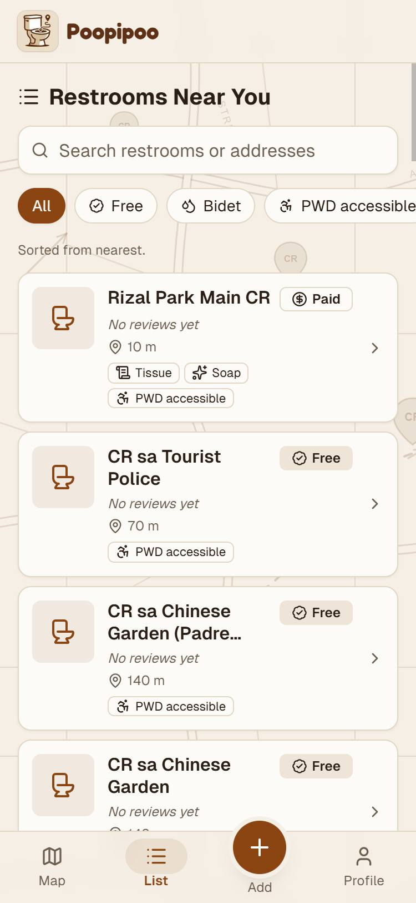 **H.2** List sorted by distance, with filters |
| 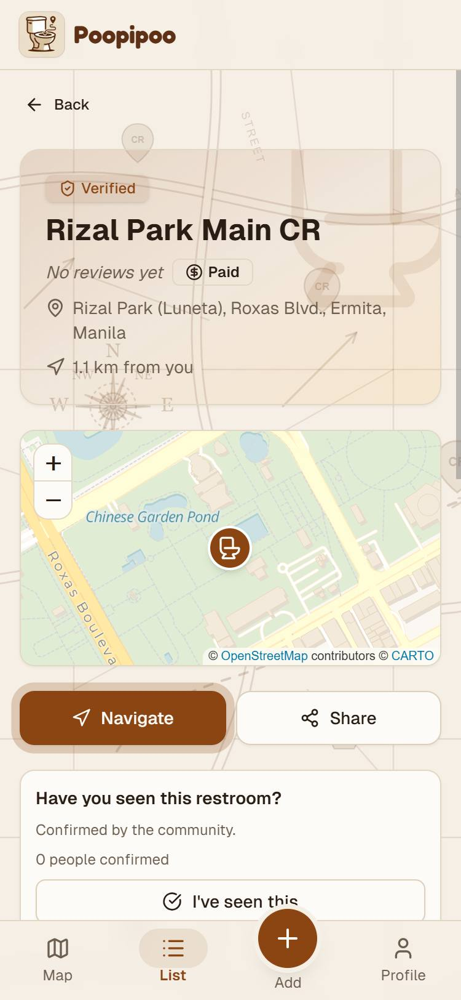 **H.3** Restroom page |  **H.4** Walking route preview with turn-by-turn directions |
| 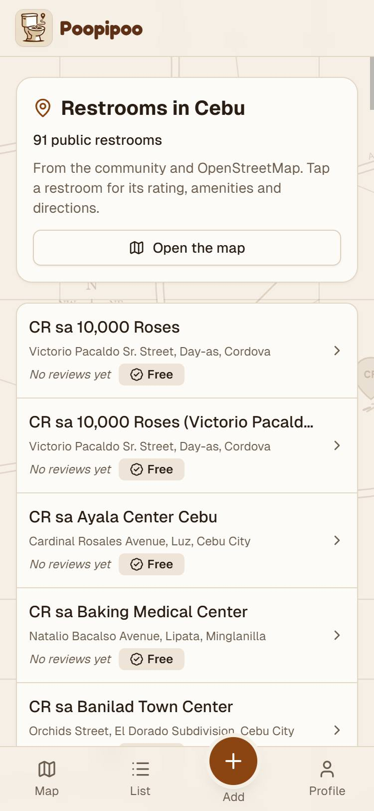 **H.5** City page (Cebu) | 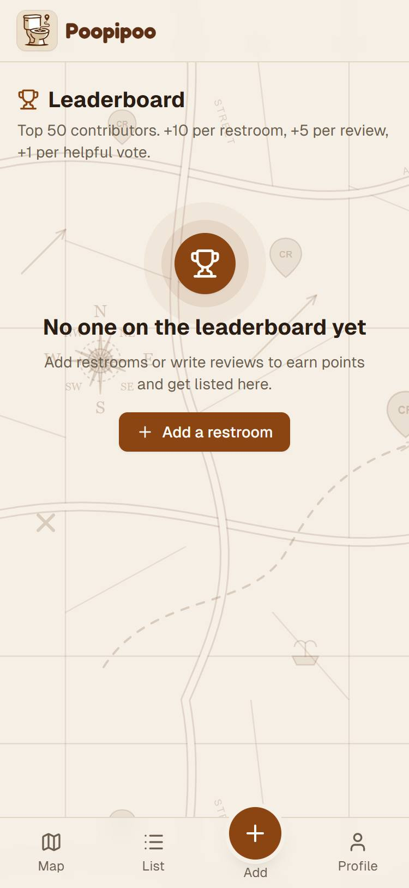 **H.6** Leaderboard |
| 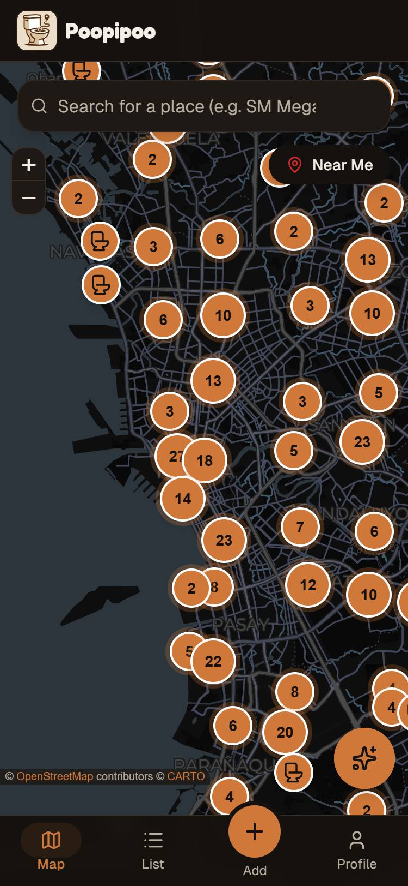 **H.7** Map in dark mode |  **H.8** AI assistant answering with restroom cards |
| 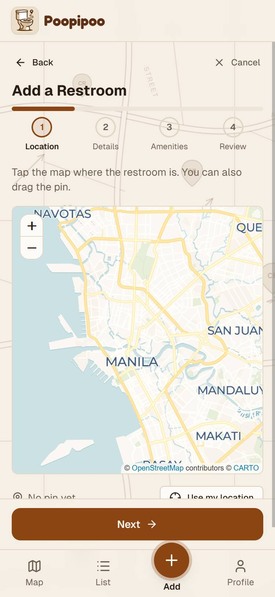 **H.9** Adding a restroom, step 1 of 4 | 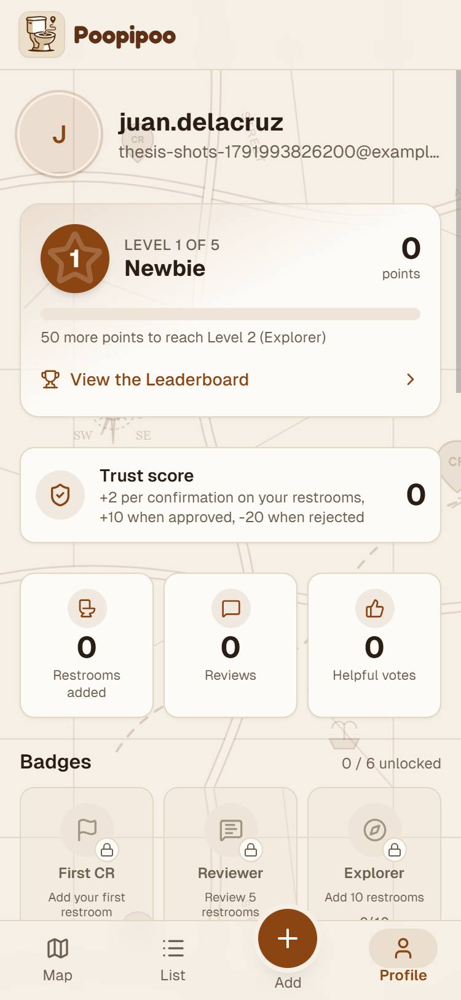 **H.10** Profile with level, points and badges |
| 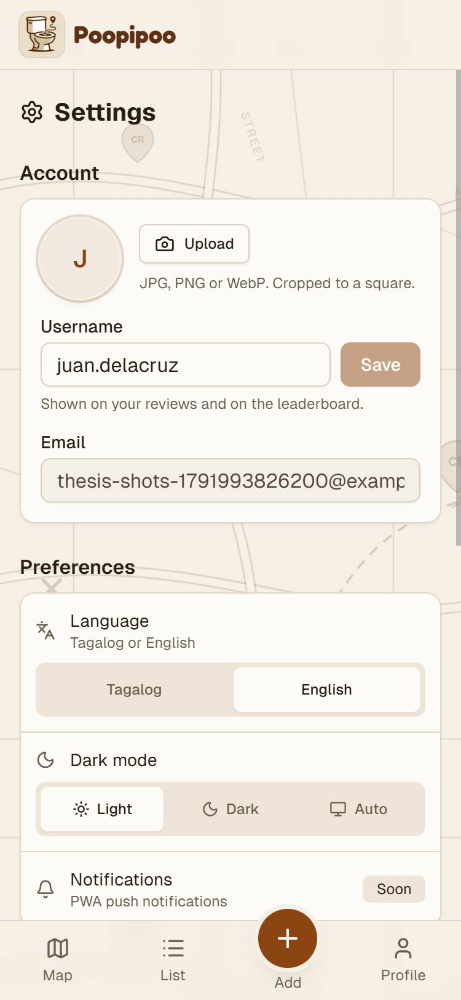 **H.11** Settings | |

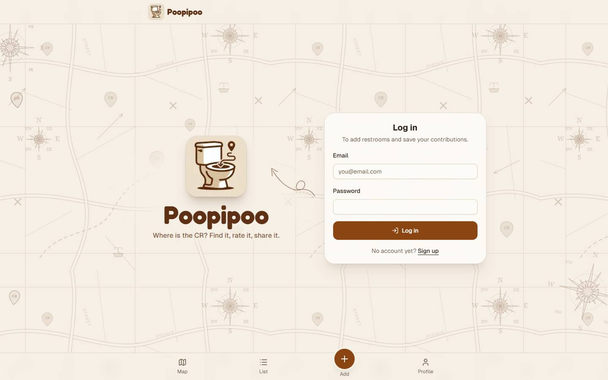

**H.12** Login page on a desktop (1440 × 900)

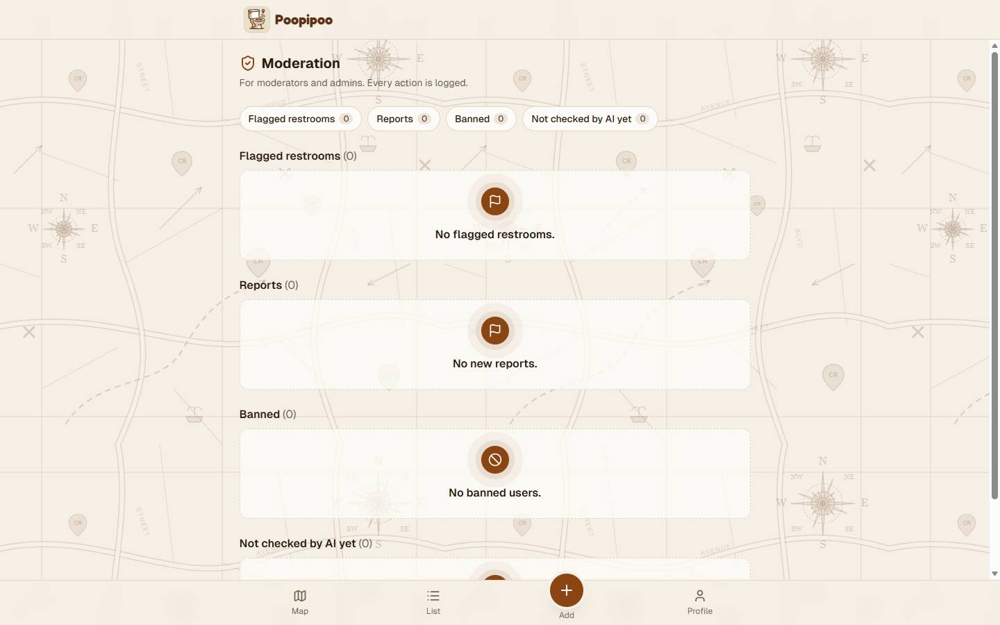

**H.13** Moderation dashboard on a desktop (no open items at the time of capture)
